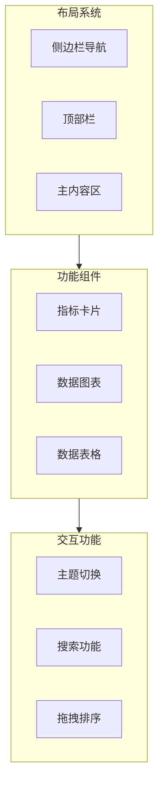

# BelieveBoy Dashboard - 项目概述

## 项目简介

BelieveBoy Dashboard 是一个基于 Next.js 和 shadcn/ui 构建的现代化管理面板。本项目复刻自 shadcn/ui 官方 Dashboard 示例 (https://ui.shadcn.com/examples/dashboard)，旨在提供一个可部署在 Vercel 上的高质量前端模板。

## 项目目标

### 核心目标

1. **完整复刻 shadcn Dashboard**: 还原官方示例的所有功能、布局和视觉效果
2. **Vercel 一键部署**: 确保项目可无缝部署到 Vercel 平台
3. **模块化组件设计**: 组件高度可复用、可扩展，便于后续定制
4. **类型安全**: 全面使用 TypeScript，确保代码质量和可维护性
5. **响应式设计**: 完美支持桌面端和移动端设备

### 项目范围

#### 包含内容

- **布局系统**: 侧边栏导航、顶部栏、主内容区域
- **数据展示**: 指标卡片、数据图表、数据表格
- **交互功能**: 主题切换、表格排序/筛选/分页、拖拽排序
- **响应式适配**: 桌面端、平板端、移动端自适应

#### 不包含内容

- 后端 API 服务（后续版本规划）
- 用户认证系统（后续版本规划）
- 数据持久化存储（后续版本规划）
- 实时数据更新（后续版本规划）

## 技术栈

| 技术 | 用途 | 版本 | 说明 |
|------|------|------|------|
| Next.js | React 框架 | 14.x+ | 使用 App Router 模式 |
| TypeScript | 类型安全 | 5.x | 启用 strict 模式 |
| Tailwind CSS | 样式系统 | 3.x | Utility-first 方式 |
| shadcn/ui | UI 组件库 | Latest | 基于 Radix UI |
| Recharts | 图表库 | 2.x | 声明式 React 图表 |
| Lucide Icons | 图标库 | Latest | 开源图标集 |
| TanStack Table | 表格库 | 8.x | 用于数据表格 |
| next-themes | 主题切换 | Latest | 明暗主题支持 |

## 功能模块概览

### 核心功能模块



### 功能模块清单

| 模块 | 描述 | 核心组件 | 状态 |
|------|------|----------|------|
| 侧边栏导航 | 可折叠的多级菜单导航 | Sidebar, SidebarProvider, SidebarMenu | 待开发 |
| 顶部栏 | 搜索、主题切换、用户菜单 | Header, Breadcrumb, ThemeToggle | 待开发 |
| 数据概览卡片 | 展示关键业务指标 | Card, MetricCard | 待开发 |
| 数据图表 | 访问趋势可视化 | Chart, AreaChart | 待开发 |
| 数据表格 | 可交互的数据列表 | DataTable, Table, Pagination | 待开发 |
| 主题系统 | 明暗主题切换 | ThemeProvider | 待开发 |

### 后续扩展规划

后端集成将在后续版本中实现：

| 版本 | 功能 | 描述 |
|------|------|------|
| v1.1 | 数据 API | RESTful API 接口集成 |
| v1.2 | 用户认证 | NextAuth.js 集成 |
| v1.3 | 数据持久化 | 数据库集成 |
| v1.4 | 实时更新 | WebSocket 支持 |

## 开发规范

### 代码规范

- 遵循 shadcn/ui 设计系统和代码风格
- 组件采用函数式组件 + Hooks 模式
- 使用 App Router 路由模式
- CSS 使用 Tailwind utility-first 方式
- 文件命名采用 kebab-case，组件命名采用 PascalCase

### 目录结构规范

```
believeboyDashboard/
├── app/                    # Next.js App Router 页面
├── components/             # React 组件
│   ├── ui/                 # shadcn/ui 基础组件
│   └── dashboard/          # Dashboard 业务组件
├── lib/                    # 工具函数和配置
├── hooks/                  # 自定义 Hooks
├── types/                  # TypeScript 类型定义
└── public/                 # 静态资源
```

## 参考资源

### 官方文档

- [shadcn/ui 官网](https://ui.shadcn.com/)
- [shadcn Dashboard 示例](https://ui.shadcn.com/examples/dashboard)
- [shadcn/ui GitHub](https://github.com/shadcn-ui/ui)
- [Next.js 文档](https://nextjs.org/docs)
- [Tailwind CSS 文档](https://tailwindcss.com/docs)

### 组件文档

- [Radix UI](https://www.radix-ui.com/) - shadcn/ui 底层原语
- [Recharts](https://recharts.org/) - 图表库文档
- [TanStack Table](https://tanstack.com/table) - 表格库文档
- [Lucide Icons](https://lucide.dev/) - 图标库文档

---

*文档版本: 1.1.0*
*更新日期: 2026-02-23*
