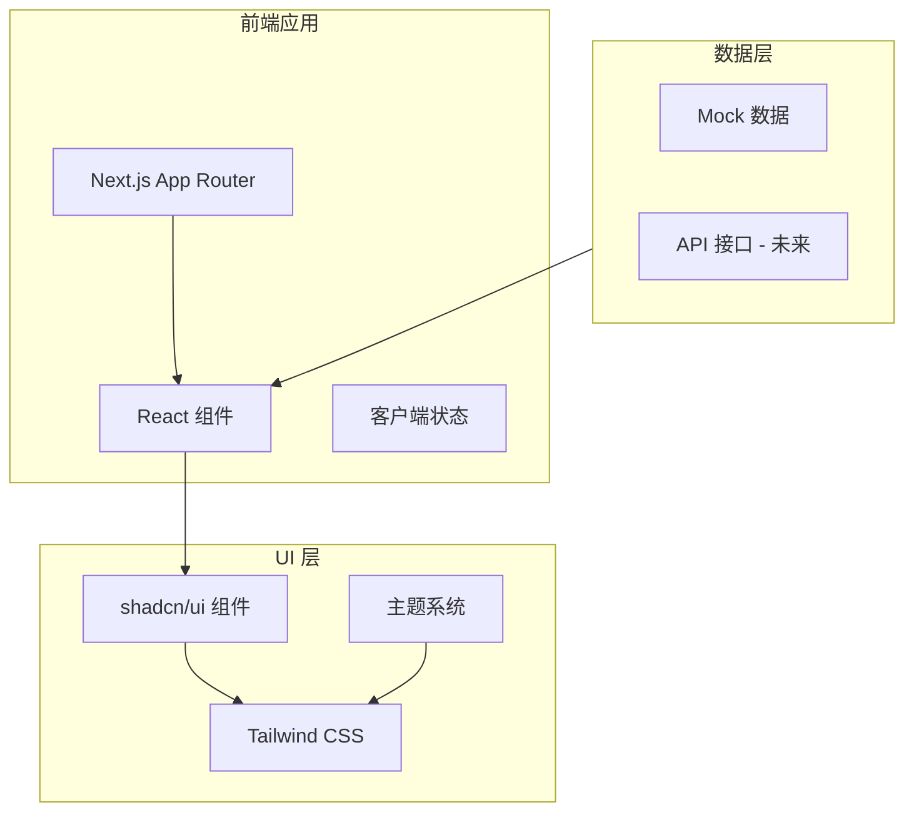

# 技术架构文档

## 整体架构

### 系统架构图



### 目录结构

```
believeboyDashboard/
├── app/                    # Next.js App Router
│   ├── layout.tsx          # 根布局
│   ├── page.tsx            # 首页
│   ├── dashboard/          # Dashboard 页面
│   │   └── page.tsx
│   └── globals.css         # 全局样式
├── components/             # React 组件
│   ├── ui/                 # shadcn/ui 基础组件
│   │   ├── sidebar.tsx     # 侧边栏组件
│   │   ├── button.tsx      # 按钮组件
│   │   ├── card.tsx        # 卡片组件
│   │   ├── table.tsx       # 表格组件
│   │   ├── chart.tsx       # 图表组件
│   │   └── ...
│   ├── dashboard/          # Dashboard 专用组件
│   │   ├── nav-main.tsx    # 主导航
│   │   ├── nav-tools.tsx   # 运营工具导航
│   │   ├── nav-user.tsx    # 用户导航
│   │   ├── metric-cards.tsx # 指标卡片
│   │   ├── charts.tsx      # 图表组件
│   │   └── data-table.tsx  # 数据表格
│   └── shared/             # 共享组件
│       ├── theme-toggle.tsx # 主题切换
│       └── search.tsx      # 搜索组件
├── lib/                    # 工具函数和配置
│   ├── utils.ts            # 通用工具函数
│   └── data.ts             # Mock 数据
├── hooks/                  # 自定义 Hooks
│   ├── use-sidebar.ts      # 侧边栏 Hook
│   └── use-theme.ts        # 主题 Hook
├── types/                  # TypeScript 类型定义
│   └── index.ts            # 类型定义
├── public/                 # 静态资源
├── Docs/                   # 项目文档
└── styles/                 # 样式文件
```

## 技术选型详解

### 1. Next.js 14 (App Router)

**选择理由:**
- 服务端渲染 (SSR) 支持
- 路由文件系统约定
- API Routes 内置支持
- Vercel 一键部署优化
- 最新的 Server Components 支持

**关键配置:**
```typescript
// next.config.js
const nextConfig = {
  reactStrictMode: true,
  images: {
    domains: [],
  },
}
```

### 2. TypeScript

**选择理由:**
- 类型安全，减少运行时错误
- 更好的 IDE 支持和自动补全
- 代码可维护性
- 团队协作友好

**配置要点:**
- 启用 strict 模式
- 路径别名 (`@/` 映射到根目录)

### 3. Tailwind CSS

**选择理由:**
- Utility-first，开发效率高
- 与 shadcn/ui 完美集成
- 生产环境自动清除无用样式
- 响应式设计内置支持

**关键配置:**
```javascript
// tailwind.config.js
module.exports = {
  darkMode: 'class',
  content: [
    './app/**/*.{js,ts,jsx,tsx}',
    './components/**/*.{js,ts,jsx,tsx}',
  ],
  theme: {
    extend: {
      keyframes: {
        'collapsible-down': {
          from: { height: '0' },
          to: { height: 'var(--radix-collapsible-content-height)' },
        },
        'collapsible-up': {
          from: { height: 'var(--radix-collapsible-content-height)' },
          to: { height: '0' },
        },
      },
      animation: {
        'collapsible-down': 'collapsible-down 260ms cubic-bezier(0.22, 1, 0.36, 1)',
        'collapsible-up': 'collapsible-up 220ms cubic-bezier(0.4, 0, 0.2, 1)',
      },
    },
  },
  plugins: [],
}
```

### 4. shadcn/ui

**选择理由:**
- 高质量、可定制的组件
- 无样式锁定，完全控制
- Radix UI 底层，无障碍支持
- 与 Tailwind 完美配合
- 复制到项目，而非 npm 依赖

**组件结构:**
```
components/ui/
├── button.tsx
├── card.tsx
├── input.tsx
├── table.tsx
├── tabs.tsx
├── dropdown-menu.tsx
├── avatar.tsx
├── badge.tsx
├── progress.tsx
├── select.tsx
├── separator.tsx
├── sheet.tsx
├── tooltip.tsx
└── ...
```

### 5. Recharts

**选择理由:**
- React 原生图表库
- 声明式 API
- 响应式支持
- 与 Tailwind 样式兼容

**使用场景:**
- 折线图：趋势数据
- 面积图：累计数据
- 柱状图：对比数据
- 饼图：占比数据

### 6. TanStack Table

**选择理由:**
- 无样式头部表格库
- 高度可定制
- 支持排序、筛选、分页
- 与 shadcn/ui 完美配合

**核心功能:**
- 列排序
- 列筛选
- 分页控制
- 行选择
- 列可见性控制

### 7. next-themes

**选择理由:**
- Next.js 专用主题解决方案
- 支持系统偏好检测
- 无闪烁切换
- SSR 友好

## Sidebar 组件架构

shadcn/ui 的 Sidebar 组件是 Dashboard 的核心布局组件，具有以下特点：

### 组件结构

```
SidebarProvider          # 上下文提供者
└── Sidebar              # 侧边栏容器
    ├── SidebarHeader    # 头部区域（Logo/品牌）
    ├── SidebarContent   # 内容区域
    │   └── SidebarGroup # 导航分组
    │       ├── SidebarGroupLabel    # 分组标题
    │       ├── SidebarGroupAction   # 分组操作按钮
    │       └── SidebarGroupContent  # 分组内容
    │           └── SidebarMenu      # 菜单容器
    │               └── SidebarMenuItem   # 菜单项
    │                   ├── SidebarMenuButton  # 菜单按钮
    │                   ├── SidebarMenuAction  # 菜单操作
    │                   ├── SidebarMenuBadge   # 菜单徽章
    │                   └── SidebarMenuSub     # 子菜单
    ├── SidebarFooter    # 底部区域（用户信息）
    └── SidebarRail      # 拖拽调整宽度轨道
```

### 核心属性

| 属性 | 类型 | 默认值 | 说明 |
|------|------|--------|------|
| side | 'left' \| 'right' | 'left' | 侧边栏位置 |
| variant | 'sidebar' \| 'floating' \| 'inset' | 'sidebar' | 视觉变体 |
| collapsible | 'offcanvas' \| 'icon' \| 'none' | 'offcanvas' | 折叠模式 |

**当前实现说明:**
- `icon` 折叠宽度已调整为 `3.5rem`，用于改善品牌区域在折叠态下的视觉居中。
- `NavDocuments` 已替换为 `NavTools`，侧边栏信息架构从通用文档导航改为运营导向导航。

### CSS 变量

```css
:root {
  --sidebar-width: 16rem;
  --sidebar-width-mobile: 18rem;
  --sidebar-background: 0 0% 98%;
  --sidebar-foreground: 240 5.3% 26.1%;
  --sidebar-primary: 240 5.9% 10%;
  --sidebar-accent: 240 4.8% 95.9%;
  --sidebar-border: 220 13% 91%;
}

.dark {
  --sidebar-background: 240 5.9% 10%;
  --sidebar-foreground: 240 4.8% 95.9%;
  --sidebar-primary: 0 0% 98%;
  --sidebar-accent: 240 3.7% 15.9%;
  --sidebar-border: 240 3.7% 15.9%;
}
```

### useSidebar Hook

```typescript
const {
  state,           // 'expanded' | 'collapsed'
  open,            // boolean - 桌面端状态
  setOpen,         // 设置桌面端状态
  openMobile,      // boolean - 移动端状态
  setOpenMobile,   // 设置移动端状态
  isMobile,        // boolean - 是否移动端
  toggleSidebar,   // 切换侧边栏
} = useSidebar()
```

## 页面结构

### Dashboard 页面布局

```
┌─────────────────────────────────────────────────────┐
│                    TopBar                           │
├──────────┬──────────────────────────────────────────┤
│          │                                          │
│  Sidebar │              Main Content               │
│          │  ┌──────────────────────────────────┐   │
│  - Home  │  │     Metrics Cards Grid           │   │
│  - Dash  │  │  ┌────┐ ┌────┐ ┌────┐ ┌────┐   │   │
│  - Life  │  │  │Card│ │Card│ │Card│ │Card│   │   │
│  - ...   │  │  └────┘ └────┘ └────┘ └────┘   │   │
│          │  └──────────────────────────────────┘   │
│          │  ┌──────────────────────────────────┐   │
│          │  │     Chart Area                   │   │
│          │  │     (Visitors Trend)             │   │
│          │  └──────────────────────────────────┘   │
│          │  ┌──────────────────────────────────┐   │
│          │  │     Data Table                   │   │
│          │  │     (Documents List)             │   │
│          │  └──────────────────────────────────┘   │
│          │                                          │
└──────────┴──────────────────────────────────────────┘
```

## 组件层级

```
App
└── Layout (RootLayout)
    └── SidebarProvider
        ├── Sidebar
        │   ├── SidebarHeader
        │   ├── SidebarNav (NavMain)
        │   ├── SidebarNav (NavSecondary)
        │   └── SidebarFooter (NavUser)
        └── MainContent
            ├── Header
            └── DashboardPage
                ├── MetricsGrid
                │   └── MetricCard x 4
                ├── ChartArea
                │   └── VisitorsChart
                └── DataTable
                    ├── TableHeader
                    ├── TableBody
                    └── TablePagination
```

## 数据流

### 当前阶段（静态数据）

```
Mock Data (lib/data.ts)
    │
    └── Components (读取静态数据)
```

### 未来阶段（API 集成）

```
API Server
    │
    └── Next.js API Routes (/api/*)
            │
            └── Server Actions / Fetch
                    │
                    └── Components (React Query / SWR)
```

## 部署架构

```
GitHub Repository
        │
        └── Vercel (自动部署)
                │
                ├── Production (main branch)
                │       └── https://dashboard.example.com
                │
                └── Preview (PR branches)
                        └── https://pr-xxx.vercel.app
```

## 性能优化策略

1. **组件级别代码分割**
   - 使用 `dynamic import` 懒加载大型图表组件

2. **图片优化**
   - Next.js Image 组件自动优化

3. **CSS 优化**
   - Tailwind CSS 按需生成

4. **字体优化**
   - `next/font` 自动优化字体加载

5. **侧边栏优化**
   - 使用 CSS 变量控制宽度，避免 JavaScript 计算
   - 折叠动画使用 CSS transition

## 关键依赖清单

```json
{
  "dependencies": {
    "next": "^14.0.0",
    "react": "^18.0.0",
    "react-dom": "^18.0.0",
    "@radix-ui/react-*": "latest",
    "recharts": "^2.0.0",
    "@tanstack/react-table": "^8.0.0",
    "next-themes": "^0.2.0",
    "lucide-react": "latest",
    "class-variance-authority": "^0.7.0",
    "clsx": "^2.0.0",
    "tailwind-merge": "^2.0.0"
  },
  "devDependencies": {
    "typescript": "^5.0.0",
    "tailwindcss": "^3.0.0",
    "autoprefixer": "^10.0.0",
    "postcss": "^8.0.0",
    "@types/node": "^20.0.0",
    "@types/react": "^18.0.0",
    "@types/react-dom": "^18.0.0"
  }
}
```

---

*文档版本: 1.1.0*
*更新日期: 2026-02-23*
