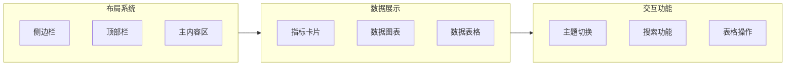
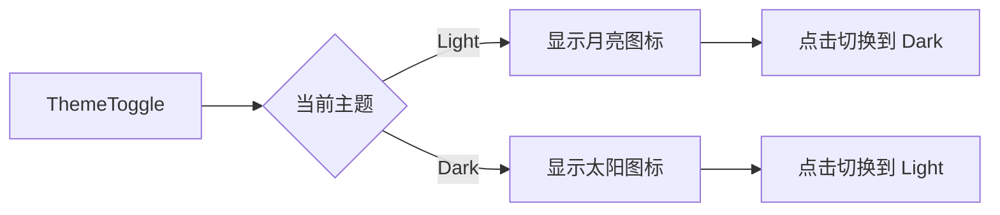

# 功能规格文档

## 功能概览

本文档详细描述 BelieveBoy Dashboard 的各项功能规格，基于 shadcn/ui Dashboard 示例进行设计。

### 功能模块总览



---

## 1. 布局系统

### 1.1 侧边栏 (Sidebar)

**功能描述:**
可折叠的侧边导航栏，包含主导航、运营工具导航、次要导航和用户信息。基于 shadcn/ui Sidebar 组件实现。

**UI 规格:**

| 属性 | 规格 |
|------|------|
| 宽度（展开） | 16rem (256px) |
| 宽度（折叠） | 3.5rem (56px) - icon 模式 |
| 宽度（移动端） | 18rem (288px) |
| 背景色 | 主题色背景 |
| 位置 | 固定左侧 |
| 响应式 | 移动端为 Sheet 抽屉模式 |

**导航菜单结构:**

```
SidebarHeader
└── Logo + 品牌名称

SidebarContent
├── NavMain (工作面板)
│   ├── 运营导航
│   │   ├── 运营总览
│   │   ├── 站点导航
│   │   └── 店铺导航
│   ├── AI 面板
│   │   ├── AI 菜单 1
│   │   ├── AI 菜单 2
│   │   └── AI 菜单 3
│   ├── 运营文件
│   │   ├── SKU 成本表
│   │   ├── 项目进度表
│   │   └── 利润测算表
│   └── 工作协作
│       ├── 工作日历
│       ├── 运营工作台
│       └── 运营公告
│
├── NavTools (运营工具)
│   ├── 数据分析
│   │   ├── 销售日报
│   │   ├── 财务月报
│   │   └── 产品分析表
│   └── 工具集
│       ├── API站点
│       ├── BLF图床
│       ├── 调研分析
│       └── 亚马逊采集
│
└── NavSecondary (次要导航)
    ├── 运营总览
    ├── 帮助中心
    └── 全局搜索

SidebarFooter
└── NavUser (用户信息)
    ├── 用户头像
    ├── 用户名称
    └── 下拉菜单
```

**交互行为:**

| 操作 | 行为 |
|------|------|
| 点击菜单项 | 导航到对应页面，高亮当前项 |
| 点击折叠按钮 | 侧边栏折叠为图标模式 |
| 展开/收起子菜单 | 使用平滑高度动画（collapsible-down/up）与透明度过渡 |
| 移动端点击遮罩 | 关闭侧边栏 |
| 键盘快捷键 | Cmd/Ctrl + B 切换侧边栏 |
| 拖拽 SidebarRail | 调整侧边栏宽度 |

**折叠模式说明:**

| 模式 | 说明 |
|------|------|
| offcanvas | 完全隐藏，点击按钮滑出 |
| icon | 折叠为图标模式，仅显示图标 |
| none | 不可折叠，始终显示 |

### 1.2 顶部栏 (Header)

**功能描述:**
固定顶部栏，包含面包屑导航、搜索、主题切换等快捷操作。

**UI 规格:**

| 属性 | 规格 |
|------|------|
| 高度 | 64px |
| 背景 | 半透明模糊效果 (backdrop-blur) |
| 位置 | 固定顶部 |
| 边框 | 底部 1px 边框 |

**包含元素:**

| 元素 | 位置 | 说明 |
|------|------|------|
| SidebarTrigger | 左侧 | 侧边栏切换按钮 |
| Breadcrumb | 左侧 | 面包屑导航 |
| Search | 中间 | 全局搜索框（可选） |
| ThemeToggle | 右侧 | 主题切换按钮 |
| UserMenu | 右侧 | 用户下拉菜单 |

### 1.3 主内容区 (Main Content)

**功能描述:**
Dashboard 的主要内容区域，包含指标卡片、图表和数据表格。

**UI 规格:**

| 属性 | 规格 |
|------|------|
| 内边距 | 24px |
| 最大宽度 | 无限制 |
| 背景 | 主题背景色 |

---

## 2. 数据概览卡片

### 2.1 指标卡片 (Metric Cards)

**功能描述:**
展示关键业务指标的卡片组件，采用 4 列网格布局。

**数据结构:**

```typescript
interface MetricCard {
  title: string;          // 指标名称
  value: string;          // 指标值
  change: string;         // 变化值（如 +12.5%）
  changeType: 'up' | 'down' | 'neutral';  // 变化方向
  description: string;    // 描述文字
  icon?: React.ReactNode; // 可选图标
}
```

**初始数据:**

| 卡片 | 标题 | 值 | 变化 | 描述 |
|------|------|-----|------|------|
| 1 | Total Revenue | $1,250.00 | +12.5% | Trending up this month |
| 2 | New Customers | 1,234 | -20% | Down 20% this period |
| 3 | Active Accounts | 45,678 | +12.5% | Strong user retention |
| 4 | Growth Rate | 4.5% | +4.5% | Steady performance increase |

**UI 规格:**

| 属性 | 规格 |
|------|------|
| 卡片内边距 | 24px |
| 边框圆角 | 12px (rounded-xl) |
| 标题字号 | 14px (text-sm) |
| 数值字号 | 24px (text-2xl font-bold) |
| 变化值颜色 | 上涨绿色 / 下跌红色 |
| 图标大小 | 16px |

**布局响应:**

| 断点 | 列数 | 说明 |
|------|------|------|
| xl (≥1280px) | 4 列 | grid-cols-4 |
| lg (≥1024px) | 4 列 | grid-cols-4 |
| md (≥768px) | 2 列 | grid-cols-2 |
| sm (<768px) | 1 列 | grid-cols-1 |

---

## 3. 数据图表

### 3.1 访问趋势图 (Area Chart)

**功能描述:**
展示过去一段时间内访问量的趋势图表，使用 Recharts 实现。

**数据结构:**

```typescript
interface ChartData {
  date: string;     // 日期 "Jan 2024"
  visitors: number; // 访问量
}
```

**图表类型:** 面积图 (Area Chart)

**UI 规格:**

| 属性 | 规格 |
|------|------|
| 图表高度 | 300px |
| X轴 | 日期（月/年） |
| Y轴 | 访问量 |
| 填充色 | 渐变填充 (主题色) |
| 线条颜色 | 主题色 |
| 网格线 | 浅色虚线 |

**时间范围选择器:**

| 选项 | 说明 |
|------|------|
| Last 3 months | 默认，显示最近 3 个月数据 |
| Last 30 days | 显示最近 30 天数据 |
| Last 7 days | 显示最近 7 天数据 |

**图表配置:**

```typescript
const chartConfig = {
  visitors: {
    label: "Visitors",
    color: "hsl(var(--primary))",
  },
}
```

---

## 4. 数据表格

### 4.1 文档表格 (Data Table)

**功能描述:**
展示运营工具与近期文件状态的可交互数据表格，基于 TanStack Table 实现。

**数据结构:**

```typescript
interface Document {
  id: string;
  header: string;         // 标题
  sectionType: string;    // 类型
  status: 'Done' | 'In Process' | 'Draft';
  target: string;         // 目标
  limit: string;          // 限制
  reviewer: string;       // 审核人
}
```

**列定义:**

| 列名 | 宽度 | 可排序 | 可筛选 | 说明 |
|------|------|--------|--------|------|
| 复选框 | 40px | - | - | 行选择 |
| Header | 40% | ✓ | ✓ | 文档标题 |
| Section Type | 15% | ✓ | ✓ | 文档类型 |
| Status | 10% | ✓ | ✓ | 状态徽章 |
| Target | 10% | - | - | 目标 |
| Limit | 10% | - | - | 限制 |
| Reviewer | 15% | - | - | 审核人 |

**功能特性:**

| 功能 | 说明 |
|------|------|
| 列排序 | 点击列头排序，支持升序/降序 |
| 行选择 | 复选框选择，支持全选/取消 |
| 分页 | 底部分页器，可调整每页行数 |
| 列可见性 | 可控制列的显示/隐藏 |
| 拖拽排序 | 支持拖拽调整行顺序 |

**分页规格:**

| 属性 | 规格 |
|------|------|
| 每页行数选项 | 10, 20, 30, 50 |
| 默认每页行数 | 10 |
| 显示总条目数 | 是 |
| 显示页码 | 是 |

**状态徽章样式:**

| 状态 | 颜色 |
|------|------|
| Done | 绿色 (bg-green-500/10 text-green-500) |
| In Process | 黄色 (bg-yellow-500/10 text-yellow-500) |
| Draft | 灰色 (bg-gray-500/10 text-gray-500) |

---

## 5. 主题系统

### 5.1 明暗主题切换

**功能描述:**
支持明亮/暗黑两种主题模式切换，使用 next-themes 实现。

**实现方式:**

| 技术 | 说明 |
|------|------|
| CSS 变量 | 驱动主题颜色 |
| Tailwind | darkMode: 'class' |
| 系统偏好 | 自动检测系统主题 |
| 本地存储 | 记忆用户选择 |

**主题变量:**

```css
:root {
  --background: 0 0% 100%;
  --foreground: 240 10% 3.9%;
  --card: 0 0% 100%;
  --card-foreground: 240 10% 3.9%;
  --primary: 240 5.9% 10%;
  --primary-foreground: 0 0% 98%;
  --secondary: 240 4.8% 95.9%;
  --secondary-foreground: 240 5.9% 10%;
  --muted: 240 4.8% 95.9%;
  --muted-foreground: 240 3.8% 46.1%;
  --accent: 240 4.8% 95.9%;
  --accent-foreground: 240 5.9% 10%;
  --border: 240 5.9% 90%;
  --ring: 240 5.9% 10%;
}

.dark {
  --background: 240 10% 3.9%;
  --foreground: 0 0% 98%;
  --card: 240 10% 3.9%;
  --card-foreground: 0 0% 98%;
  --primary: 0 0% 98%;
  --primary-foreground: 240 5.9% 10%;
  --secondary: 240 3.7% 15.9%;
  --secondary-foreground: 0 0% 98%;
  --muted: 240 3.7% 15.9%;
  --muted-foreground: 240 5% 64.9%;
  --accent: 240 3.7% 15.9%;
  --accent-foreground: 0 0% 98%;
  --border: 240 3.7% 15.9%;
  --ring: 240 4.9% 83.9%;
}
```

**主题切换组件:**



---

## 6. 响应式设计

### 6.1 断点定义

| 断点 | 宽度范围 | Tailwind 类 | 布局说明 |
|------|----------|-------------|----------|
| xs | < 640px | - | 单列，侧边栏 Sheet |
| sm | ≥ 640px | sm: | 单列，侧边栏 Sheet |
| md | ≥ 768px | md: | 双列，侧边栏可折叠 |
| lg | ≥ 1024px | lg: | 四列网格 |
| xl | ≥ 1280px | xl: | 四列网格 |
| 2xl | ≥ 1536px | 2xl: | 四列网格，最大宽度 |

### 6.2 移动端适配

| 组件 | 桌面端 | 移动端 |
|------|--------|--------|
| 侧边栏 | 固定显示 | Sheet 抽屉模式 |
| 卡片网格 | 4 列 | 1 列 |
| 数据表格 | 完整显示 | 水平滚动 |
| 顶部栏 | 完整显示 | 简化显示 |
| 导航菜单 | 完整显示 | 折叠菜单 |

---

## 7. 用户交互

### 7.1 拖拽排序

**功能描述:**
表格支持拖拽重新排列行顺序。

**实现方案:**

| 技术 | 说明 |
|------|------|
| @dnd-kit/core | 拖拽核心库 |
| @dnd-kit/sortable | 排序功能 |
| @dnd-kit/utilities | 工具函数 |

**交互行为:**

| 操作 | 行为 |
|------|------|
| 拖拽开始 | 行高亮，显示拖拽图标 |
| 拖拽中 | 实时预览放置位置 |
| 放置 | 更新数据顺序 |
| 取消 | 恢复原位置 |

### 7.2 行选择

**功能描述:**
支持单选和多选表格行。

**交互方式:**

| 操作 | 行为 |
|------|------|
| 点击复选框 | 切换该行选中状态 |
| Shift+点击 | 范围选择 |
| 点击表头复选框 | 全选/取消全选 |
| 显示已选数量 | 底部显示 "已选择 X 项" |

### 7.3 搜索功能

**功能描述:**
全局搜索功能，支持命令面板模式。

**实现方案:**

| 技术 | 说明 |
|------|------|
| cmdk | 命令面板组件 |
| Lucide Icons | 搜索图标 |

**快捷键:**

| 快捷键 | 功能 |
|--------|------|
| Cmd/Ctrl + K | 打开搜索面板 |
| Escape | 关闭搜索面板 |

---

## 8. 组件清单

### 8.1 shadcn/ui 组件

| 组件 | 用途 | 文件 |
|------|------|------|
| Sidebar | 侧边栏 | sidebar.tsx |
| Button | 按钮 | button.tsx |
| Card | 卡片 | card.tsx |
| Table | 表格 | table.tsx |
| Chart | 图表 | chart.tsx |
| Badge | 徽章 | badge.tsx |
| Avatar | 头像 | avatar.tsx |
| Dropdown | 下拉菜单 | dropdown-menu.tsx |
| Dialog | 对话框 | dialog.tsx |
| Sheet | 抽屉 | sheet.tsx |
| Separator | 分隔线 | separator.tsx |
| Tooltip | 提示 | tooltip.tsx |
| Checkbox | 复选框 | checkbox.tsx |
| Select | 选择器 | select.tsx |
| Input | 输入框 | input.tsx |
| Command | 命令面板 | command.tsx |
| Breadcrumb | 面包屑 | breadcrumb.tsx |
| Collapsible | 折叠面板 | collapsible.tsx |
| ScrollArea | 滚动区域 | scroll-area.tsx |
| Skeleton | 骨架屏 | skeleton.tsx |

### 8.2 业务组件

| 组件 | 用途 | 文件 |
|------|------|------|
| AppSidebar | 应用侧边栏 | app-sidebar.tsx |
| NavMain | 主导航 | nav-main.tsx |
| NavUser | 用户导航 | nav-user.tsx |
| NavTools | 运营工具导航 | nav-tools.tsx |
| NavSecondary | 次要导航 | nav-secondary.tsx |
| MetricCards | 指标卡片组 | metric-cards.tsx |
| DataTable | 数据表格 | data-table.tsx |
| ThemeToggle | 主题切换 | theme-toggle.tsx |
| SearchCommand | 搜索命令面板 | search-command.tsx |

---

*文档版本: 1.1.0*
*更新日期: 2026-02-23*
