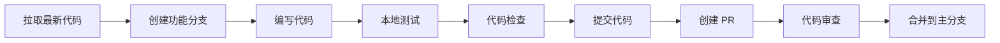

# 开发指南

## 环境准备

### 系统要求

| 工具 | 版本要求 | 说明 |
|------|----------|------|
| Node.js | ≥ 18.17.0 | LTS 版本推荐 |
| pnpm | ≥ 8.0.0 | 推荐使用 pnpm |
| npm | ≥ 9.0.0 | 或使用 npm |
| Git | ≥ 2.0.0 | 版本控制 |

### 推荐开发工具

| 工具 | 用途 |
|------|------|
| VS Code | 代码编辑器 |
| Chrome/Edge | 浏览器调试 |
| React DevTools | React 调试 |

### VS Code 扩展推荐

```
- ESLint
- Prettier
- Tailwind CSS IntelliSense
- TypeScript Vue Plugin (Volar)
- Path Intellisense
```

---

## 项目初始化

### 方式一：从零创建项目

```bash
# 1. 创建 Next.js 项目
pnpm create next-app@latest believeboyDashboard --typescript --tailwind --eslint --app --src-dir=false --import-alias="@/*"

# 2. 进入项目目录
cd believeboyDashboard

# 3. 安装 shadcn/ui
pnpm dlx shadcn@latest init

# 4. 安装所需组件
pnpm dlx shadcn@latest add sidebar
pnpm dlx shadcn@latest add button
pnpm dlx shadcn@latest add card
pnpm dlx shadcn@latest add table
pnpm dlx shadcn@latest add chart
pnpm dlx shadcn@latest add badge
pnpm dlx shadcn@latest add avatar
pnpm dlx shadcn@latest add dropdown-menu
pnpm dlx shadcn@latest add dialog
pnpm dlx shadcn@latest add sheet
pnpm dlx shadcn@latest add separator
pnpm dlx shadcn@latest add tooltip
pnpm dlx shadcn@latest add checkbox
pnpm dlx shadcn@latest add select
pnpm dlx shadcn@latest add input
pnpm dlx shadcn@latest add command
pnpm dlx shadcn@latest add breadcrumb
pnpm dlx shadcn@latest add collapsible
pnpm dlx shadcn@latest add scroll-area
pnpm dlx shadcn@latest add skeleton

# 5. 安装其他依赖
pnpm add next-themes
pnpm add @tanstack/react-table
pnpm add recharts
pnpm add lucide-react
pnpm add class-variance-authority
pnpm add clsx
pnpm add tailwind-merge
```

### 方式二：克隆现有项目

```bash
# 1. 克隆仓库
git clone <repository-url>
cd believeboyDashboard

# 2. 安装依赖
pnpm install

# 3. 启动开发服务器
pnpm dev
```

---

## 开发流程

### 本地开发

```bash
# 启动开发服务器
pnpm dev

# 访问 http://localhost:3000
```

### 构建与预览

```bash
# 构建生产版本
pnpm build

# 预览生产版本
pnpm start

# 导出静态站点（可选）
pnpm build && pnpm export
```

### 代码检查

```bash
# 运行 ESLint
pnpm lint

# 修复 ESLint 错误
pnpm lint --fix

# 类型检查
pnpm tsc --noEmit
```

### 开发工作流



---

## 代码规范

### 文件命名规范

| 类型 | 规范 | 示例 |
|------|------|------|
| 组件文件 | PascalCase | `Button.tsx`, `Sidebar.tsx` |
| 工具函数 | camelCase | `utils.ts`, `helpers.ts` |
| 页面文件 | 小写 | `page.tsx`, `layout.tsx` |
| 类型文件 | camelCase | `types.ts`, `index.ts` |
| 样式文件 | 小写 | `globals.css` |
| 配置文件 | 小写+点 | `tailwind.config.js` |

### 目录命名规范

| 类型 | 规范 | 示例 |
|------|------|------|
| 组件目录 | 小写 | `components/ui/` |
| 页面目录 | 小写 | `app/dashboard/` |
| 工具目录 | 小写 | `lib/`, `hooks/` |

### 组件编写规范

#### 组件结构

```typescript
// 1. 导入语句
import { useState } from 'react'
import { Button } from '@/components/ui/button'

// 2. 类型定义
interface MyComponentProps {
  title: string
  onClick?: () => void
}

// 3. 组件定义
export function MyComponent({ title, onClick }: MyComponentProps) {
  // 3.1 Hooks
  const [state, setState] = useState(false)
  
  // 3.2 事件处理函数
  const handleClick = () => {
    setState(!state)
    onClick?.()
  }
  
  // 3.3 渲染
  return (
    <div className="...">
      <h1>{title}</h1>
      <Button onClick={handleClick}>Click me</Button>
    </div>
  )
}
```

#### 导出规范

```typescript
// 默认导出（页面组件）
export default function Page() {
  return <div>Page</div>
}

// 命名导出（可复用组件）
export function Button() {
  return <button>Button</button>
}

// 桶文件导出
// components/ui/index.ts
export * from './button'
export * from './card'
```

### TypeScript 规范

#### 类型定义

```typescript
// 使用 interface 定义对象类型
interface User {
  id: string
  name: string
  email: string
}

// 使用 type 定义联合类型
type Status = 'pending' | 'active' | 'completed'

// 使用泛型定义通用类型
interface ApiResponse<T> {
  data: T
  status: number
  message: string
}
```

#### 类型导入

```typescript
// 使用 type 关键字导入类型
import type { Metadata } from 'next'
import type { User, Status } from '@/types'
```

### CSS 规范

#### Tailwind 类名顺序

```typescript
// 推荐顺序：布局 → 尺寸 → 间距 → 排版 → 背景 → 边框 → 效果
<div className="flex items-center justify-between w-full p-4 text-sm bg-white border rounded-lg shadow-sm">
```

### Dashboard 侧边栏专项约定

- 业务导航分组使用 `components/dashboard/nav-main.tsx`，运营工具分组使用 `components/dashboard/nav-tools.tsx`。
- 当前运营工具分组为：数据分析、工具集、数据管理（SKU成本、店铺信息）。
- 如需修改侧边栏折叠宽度，请同步 `components/ui/sidebar.tsx` 中 `SIDEBAR_WIDTH_ICON`（当前为 `3.5rem`）。
- 侧边栏子菜单展开/收起动画统一使用 Tailwind 扩展动画：
  - `animate-collapsible-down`
  - `animate-collapsible-up`
- 动画 keyframes 与 timing 统一维护在 `tailwind.config.ts`，避免组件内重复定义。

#### 自定义样式

```typescript
// 使用 cn 函数合并类名
import { cn } from '@/lib/utils'

<div className={cn(
  'base-classes',
  condition && 'conditional-classes',
  className
)}>
```

#### CSS 变量使用

```css
/* 使用 CSS 变量定义主题色 */
.custom-element {
  background-color: hsl(var(--primary));
  color: hsl(var(--primary-foreground));
}
```

---

## Git 规范

### 分支命名

| 分支类型 | 命名规范 | 示例 |
|----------|----------|------|
| 主分支 | main | `main` |
| 开发分支 | develop | `develop` |
| 功能分支 | feature/* | `feature/sidebar` |
| 修复分支 | fix/* | `fix/table-sort` |
| 发布分支 | release/* | `release/v1.0.0` |

### Commit 消息规范

```
<type>(<scope>): <subject>

<body>

<footer>
```

#### Type 类型

| Type | 说明 |
|------|------|
| feat | 新功能 |
| fix | 修复 Bug |
| docs | 文档更新 |
| style | 代码格式调整 |
| refactor | 重构代码 |
| perf | 性能优化 |
| test | 测试相关 |
| chore | 构建/工具相关 |

#### 示例

```bash
# 新功能
feat(sidebar): add collapsible sidebar component

# 修复 Bug
fix(table): resolve sorting issue in data table

# 文档更新
docs(readme): update installation instructions

# 重构
refactor(chart): extract chart configuration to separate file
```

---

## 组件开发指南

### 添加新组件

```bash
# 使用 shadcn/ui CLI 添加组件
pnpm dlx shadcn@latest add <component-name>

# 示例
pnpm dlx shadcn@latest add tabs
```

### 自定义组件开发

#### 1. 创建组件文件

```typescript
// components/dashboard/my-component.tsx
'use client'

import { Card, CardContent, CardHeader, CardTitle } from '@/components/ui/card'

interface MyComponentProps {
  title: string
  data: Array<{ name: string; value: number }>
}

export function MyComponent({ title, data }: MyComponentProps) {
  return (
    <Card>
      <CardHeader>
        <CardTitle>{title}</CardTitle>
      </CardHeader>
      <CardContent>
        {/* 组件内容 */}
      </CardContent>
    </Card>
  )
}
```

#### 2. 在页面中使用

```typescript
// app/dashboard/page.tsx
import { MyComponent } from '@/components/dashboard/my-component'

export default function DashboardPage() {
  return (
    <div>
      <MyComponent title="My Data" data={[]} />
    </div>
  )
}
```

### 状态管理

#### 本地状态

```typescript
'use client'

import { useState } from 'react'

export function Counter() {
  const [count, setCount] = useState(0)
  
  return (
    <button onClick={() => setCount(count + 1)}>
      Count: {count}
    </button>
  )
}
```

#### 全局状态（使用 Context）

```typescript
// lib/context/sidebar.tsx
'use client'

import { createContext, useContext, useState } from 'react'

interface SidebarContextType {
  isOpen: boolean
  toggle: () => void
}

const SidebarContext = createContext<SidebarContextType | undefined>(undefined)

export function SidebarProvider({ children }: { children: React.ReactNode }) {
  const [isOpen, setIsOpen] = useState(true)
  
  return (
    <SidebarContext.Provider value={{ isOpen, toggle: () => setIsOpen(!isOpen) }}>
      {children}
    </SidebarContext.Provider>
  )
}

export function useSidebarContext() {
  const context = useContext(SidebarContext)
  if (!context) {
    throw new Error('useSidebarContext must be used within SidebarProvider')
  }
  return context
}
```

---

## 调试技巧

### React DevTools

1. 安装 React DevTools 浏览器扩展
2. 打开开发者工具，切换到 Components 或 Profiler 标签
3. 检查组件树、Props、State 等

### Console 调试

```typescript
// 使用 console.log 调试
console.log('Debug info:', { variable })

// 使用 console.table 查看数组/对象
console.table(data)

// 使用 console.time 测量性能
console.time('operation')
// ... 操作
console.timeEnd('operation')
```

### VS Code 调试

在 `.vscode/launch.json` 中配置：

```json
{
  "version": "0.2.0",
  "configurations": [
    {
      "name": "Next.js: debug full stack",
      "type": "node-terminal",
      "request": "launch",
      "command": "pnpm dev"
    }
  ]
}
```

---

## 常见问题

### 1. 组件样式不生效

**原因**: Tailwind CSS 类名未被正确扫描

**解决方案**:
```javascript
// tailwind.config.js
module.exports = {
  content: [
    './app/**/*.{js,ts,jsx,tsx}',
    './components/**/*.{js,ts,jsx,tsx}',
  ],
}
```

### 2. 主题切换闪烁

**原因**: SSR 时主题未正确初始化

**解决方案**:
```typescript
// 使用 next-themes 的 suppressHydrationWarning
<html lang="en" suppressHydrationWarning>
```

### 3. 图表不显示

**原因**: Recharts 组件未正确导入或数据格式错误

**解决方案**:
```typescript
// 确保使用正确的导入
import { AreaChart, Area, XAxis, YAxis, CartesianGrid } from 'recharts'

// 确保数据格式正确
const data = [
  { date: 'Jan', value: 100 },
  { date: 'Feb', value: 200 },
]
```

---

## 参考资源

### 官方文档

- [Next.js 文档](https://nextjs.org/docs)
- [shadcn/ui 文档](https://ui.shadcn.com/docs)
- [Tailwind CSS 文档](https://tailwindcss.com/docs)
- [TypeScript 文档](https://www.typescriptlang.org/docs/)

### 组件库文档

- [Radix UI](https://www.radix-ui.com/docs)
- [Recharts](https://recharts.org/en-US/api)
- [TanStack Table](https://tanstack.com/table/v8/docs/)

### 工具文档

- [pnpm](https://pnpm.io/motivation)
- [ESLint](https://eslint.org/docs/latest/)
- [Prettier](https://prettier.io/docs/en/index.html)

---

*文档版本: 1.0.0*
*创建日期: 2026-02-23*
