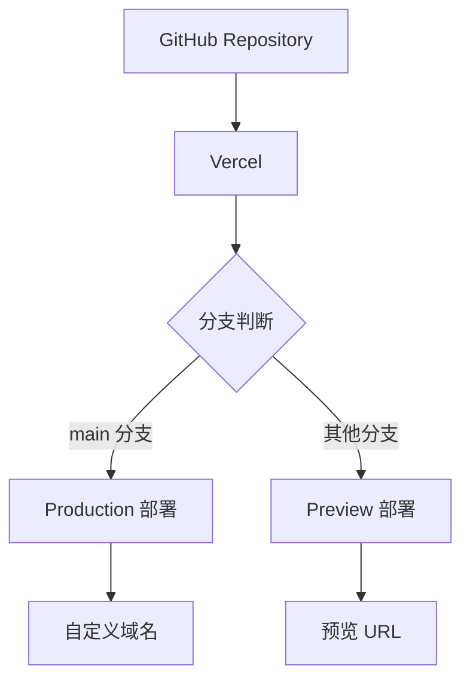

# 部署指南

## 部署概述

本项目推荐使用 Vercel 进行部署，Vercel 是 Next.js 的官方托管平台，提供：

- 零配置部署
- 自动 HTTPS
- 全球 CDN 加速
- 预览部署（PR 预览）
- 自动 CI/CD

### 部署架构



---

## Vercel 部署

### 方式一：通过 Vercel Dashboard（推荐）

#### 步骤 1：准备 GitHub 仓库

```bash
# 初始化 Git 仓库（如果尚未初始化）
git init

# 添加所有文件
git add .

# 提交代码
git commit -m "feat: initial commit"

# 添加远程仓库
git remote add origin https://github.com/username/believeboyDashboard.git

# 推送到 GitHub
git push -u origin main
```

#### 步骤 2：连接 Vercel

1. 访问 [Vercel](https://vercel.com/)
2. 使用 GitHub 账号登录
3. 点击 "Add New..." → "Project"
4. 选择 `believeboyDashboard` 仓库
5. 点击 "Import"

#### 步骤 3：配置项目

| 配置项 | 值 |
|--------|-----|
| Framework Preset | Next.js |
| Root Directory | ./ |
| Build Command | `pnpm build` |
| Output Directory | `.next` |
| Install Command | `pnpm install` |

#### 步骤 4：环境变量（可选）

如果项目需要环境变量，在 "Environment Variables" 部分添加：

```
NEXT_PUBLIC_API_URL=https://api.example.com
```

#### 步骤 5：部署

1. 点击 "Deploy"
2. 等待构建完成
3. 访问分配的 URL

### 方式二：通过 Vercel CLI

#### 步骤 1：安装 Vercel CLI

```bash
# 使用 pnpm
pnpm add -g vercel

# 或使用 npm
npm install -g vercel
```

#### 步骤 2：登录 Vercel

```bash
vercel login
```

#### 步骤 3：部署项目

```bash
# 进入项目目录
cd believeboyDashboard

# 部署到预览环境
vercel

# 部署到生产环境
vercel --prod
```

#### 步骤 4：查看部署状态

```bash
# 查看项目列表
vercel list

# 查看部署详情
vercel inspect <deployment-url>
```

---

## 项目配置

### vercel.json 配置

在项目根目录创建 `vercel.json` 文件：

```json
{
  "buildCommand": "pnpm build",
  "devCommand": "pnpm dev",
  "installCommand": "pnpm install",
  "framework": "nextjs",
  "regions": ["hkg1"],
  "headers": [
    {
      "source": "/(.*)",
      "headers": [
        {
          "key": "X-Content-Type-Options",
          "value": "nosniff"
        },
        {
          "key": "X-Frame-Options",
          "value": "DENY"
        },
        {
          "key": "X-XSS-Protection",
          "value": "1; mode=block"
        }
      ]
    }
  ]
}
```

### next.config.js 配置

```javascript
/** @type {import('next').NextConfig} */
const nextConfig = {
  reactStrictMode: true,
  images: {
    domains: [],
    unoptimized: false,
  },
  // 输出独立构建（可选，用于 Docker 部署）
  // output: 'standalone',
}

module.exports = nextConfig
```

---

## 自定义域名

### 添加域名

1. 在 Vercel Dashboard 中打开项目
2. 进入 "Settings" → "Domains"
3. 输入自定义域名（如 `dashboard.example.com`）
4. 点击 "Add"

### DNS 配置

根据 Vercel 提供的指引配置 DNS：

| 记录类型 | 名称 | 值 |
|----------|------|-----|
| A | @ | 76.76.21.21 |
| CNAME | www | cname.vercel-dns.com |
| CNAME | dashboard | cname.vercel-dns.com |

### SSL 证书

Vercel 自动为自定义域名配置 SSL 证书：

- 自动续期
- 支持 HTTP/2
- 强制 HTTPS（可配置）

---

## 环境变量管理

### 添加环境变量

#### 通过 Dashboard

1. 进入 "Settings" → "Environment Variables"
2. 添加变量名和值
3. 选择环境：Production / Preview / Development

#### 通过 CLI

```bash
# 添加环境变量
vercel env add NEXT_PUBLIC_API_URL

# 列出环境变量
vercel env ls

# 删除环境变量
vercel env rm NEXT_PUBLIC_API_URL
```

### 环境变量命名规范

| 前缀 | 用途 | 示例 |
|------|------|------|
| NEXT_PUBLIC_ | 客户端可访问 | NEXT_PUBLIC_API_URL |
| 无前缀 | 仅服务端访问 | DATABASE_URL |

### .env 文件

```bash
# .env.local（本地开发）
NEXT_PUBLIC_API_URL=http://localhost:3001/api

# .env.production（生产环境）
NEXT_PUBLIC_API_URL=https://api.example.com
```

> **注意**: `.env.local` 文件应添加到 `.gitignore`，不要提交到仓库。

---

## CI/CD 配置

### 自动部署

Vercel 会自动监听 GitHub 仓库的变化：

| 触发条件 | 部署类型 |
|----------|----------|
| 推送到 main 分支 | Production |
| 创建 Pull Request | Preview |
| 更新 Pull Request | Preview 更新 |

### GitHub Actions 集成（可选）

创建 `.github/workflows/deploy.yml`：

```yaml
name: Deploy to Vercel

on:
  push:
    branches:
      - main
  pull_request:
    branches:
      - main

jobs:
  deploy:
    runs-on: ubuntu-latest
    steps:
      - name: Checkout
        uses: actions/checkout@v4

      - name: Setup Node.js
        uses: actions/setup-node@v4
        with:
          node-version: '20'

      - name: Setup pnpm
        uses: pnpm/action-setup@v2
        with:
          version: 8

      - name: Install dependencies
        run: pnpm install

      - name: Run tests
        run: pnpm test

      - name: Build
        run: pnpm build

      - name: Deploy to Vercel
        uses: amondnet/vercel-action@v25
        with:
          vercel-token: ${{ secrets.VERCEL_TOKEN }}
          vercel-org-id: ${{ secrets.VERCEL_ORG_ID }}
          vercel-project-id: ${{ secrets.VERCEL_PROJECT_ID }}
          vercel-args: '--prod'
```

### 配置 Secrets

在 GitHub 仓库设置中添加 Secrets：

| Secret | 说明 |
|--------|------|
| VERCEL_TOKEN | Vercel API Token |
| VERCEL_ORG_ID | Vercel 组织 ID |
| VERCEL_PROJECT_ID | Vercel 项目 ID |

获取方式：
```bash
# 获取项目信息
vercel link

# 查看 .vercel/project.json
cat .vercel/project.json
```

---

## 部署检查清单

### 部署前检查

- [ ] 代码已提交到 Git 仓库
- [ ] 所有测试通过
- [ ] ESLint 检查通过
- [ ] TypeScript 类型检查通过
- [ ] 本地构建成功
- [ ] 环境变量已配置

### 部署后检查

- [ ] 网站可正常访问
- [ ] 主题切换正常工作
- [ ] 侧边栏功能正常
- [ ] 数据表格功能正常
- [ ] 图表显示正常
- [ ] 响应式布局正常
- [ ] 控制台无错误

### 性能检查

- [ ] Lighthouse 性能评分 ≥ 90
- [ ] First Contentful Paint < 1.5s
- [ ] Largest Contentful Paint < 2.5s
- [ ] Cumulative Layout Shift < 0.1

---

## 监控与日志

### Vercel Analytics

启用 Vercel Analytics：

1. 进入项目 "Settings" → "Analytics"
2. 点击 "Enable Analytics"
3. 安装 Analytics 包：

```bash
pnpm add @vercel/analytics
```

4. 在 `app/layout.tsx` 中添加：

```typescript
import { Analytics } from '@vercel/analytics/react'

export default function RootLayout({ children }) {
  return (
    <html>
      <body>
        {children}
        <Analytics />
      </body>
    </html>
  )
}
```

### 查看日志

1. 进入 Vercel Dashboard
2. 选择项目
3. 点击 "Deployments"
4. 选择部署版本
5. 点击 "Functions" 或 "Runtime Logs"

### 日志查询

```bash
# 通过 CLI 查看日志
vercel logs <deployment-url>

# 实时日志
vercel logs <deployment-url> --follow
```

---

## 回滚部署

### 通过 Dashboard

1. 进入项目 "Deployments"
2. 找到要回滚的版本
3. 点击 "..." → "Promote to Production"

### 通过 CLI

```bash
# 列出部署历史
vercel list

# 回滚到指定版本
vercel rollback <deployment-url>
```

---

## 故障排除

### 常见问题

#### 1. 构建失败

**错误**: `Build failed`

**解决方案**:
```bash
# 本地测试构建
pnpm build

# 检查 Node.js 版本
node -v  # 应为 18.x 或更高

# 清除缓存重新构建
rm -rf .next node_modules
pnpm install
pnpm build
```

#### 2. 环境变量未生效

**错误**: 环境变量为 undefined

**解决方案**:
- 确认变量名以 `NEXT_PUBLIC_` 开头（客户端访问）
- 检查 Vercel Dashboard 中的环境变量配置
- 重新部署项目

#### 3. 主题闪烁

**错误**: 页面加载时主题闪烁

**解决方案**:
```typescript
// app/layout.tsx
<html lang="en" suppressHydrationWarning>
```

#### 4. 404 错误

**错误**: 刷新页面显示 404

**解决方案**:
- 确认使用 Next.js App Router
- 检查 `vercel.json` 路由配置

### 获取帮助

- [Vercel 文档](https://vercel.com/docs)
- [Next.js 部署文档](https://nextjs.org/docs/deployment)
- [Vercel GitHub Discussions](https://github.com/vercel/vercel/discussions)

---

## 其他部署选项

### Docker 部署

#### 1. 修改 next.config.js

```javascript
const nextConfig = {
  output: 'standalone',
}
```

#### 2. 创建 Dockerfile

```dockerfile
FROM node:18-alpine AS base

# 安装依赖
FROM base AS deps
RUN apk add --no-cache libc6-compat
WORKDIR /app
COPY package.json pnpm-lock.yaml ./
RUN npm install -g pnpm
RUN pnpm install --frozen-lockfile

# 构建
FROM base AS builder
WORKDIR /app
COPY --from=deps /app/node_modules ./node_modules
COPY . .
RUN npm install -g pnpm
RUN pnpm build

# 运行
FROM base AS runner
WORKDIR /app
ENV NODE_ENV production
RUN addgroup --system --gid 1001 nodejs
RUN adduser --system --uid 1001 nextjs

COPY --from=builder /app/public ./public
COPY --from=builder --chown=nextjs:nodejs /app/.next/standalone ./
COPY --from=builder --chown=nextjs:nodejs /app/.next/static ./.next/static

USER nextjs
EXPOSE 3000
ENV PORT 3000

CMD ["node", "server.js"]
```

#### 3. 构建和运行

```bash
# 构建镜像
docker build -t believeboy-dashboard .

# 运行容器
docker run -p 3000:3000 believeboy-dashboard
```

### 静态导出

```javascript
// next.config.js
const nextConfig = {
  output: 'export',
  trailingSlash: true,
}
```

```bash
# 构建
pnpm build

# 输出在 out/ 目录
```

> **注意**: 静态导出不支持 Next.js 的所有功能（如 API Routes、ISR）。

---

## 参考资源

### Vercel 文档

- [Vercel 部署文档](https://vercel.com/docs/deployments)
- [Next.js on Vercel](https://vercel.com/docs/frameworks/nextjs)
- [环境变量](https://vercel.com/docs/environment-variables)
- [自定义域名](https://vercel.com/docs/projects/domains)

### 其他资源

- [Next.js 部署文档](https://nextjs.org/docs/deployment)
- [Docker 部署 Next.js](https://github.com/vercel/next.js/tree/canary/examples/with-docker)

---

*文档版本: 1.0.0*
*创建日期: 2026-02-23*