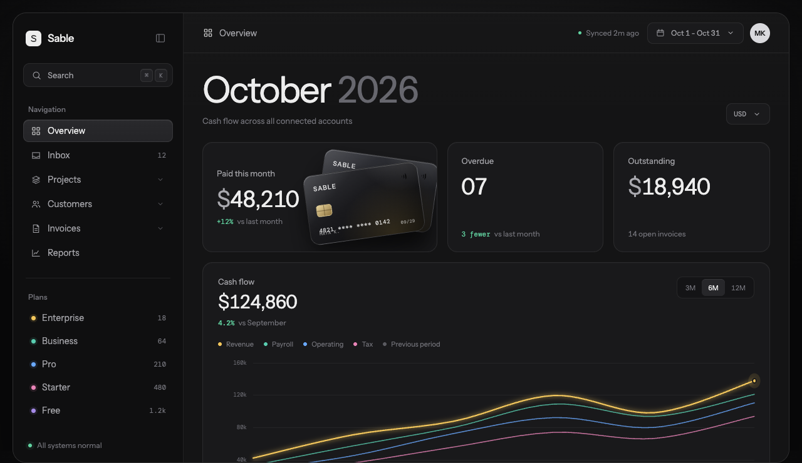
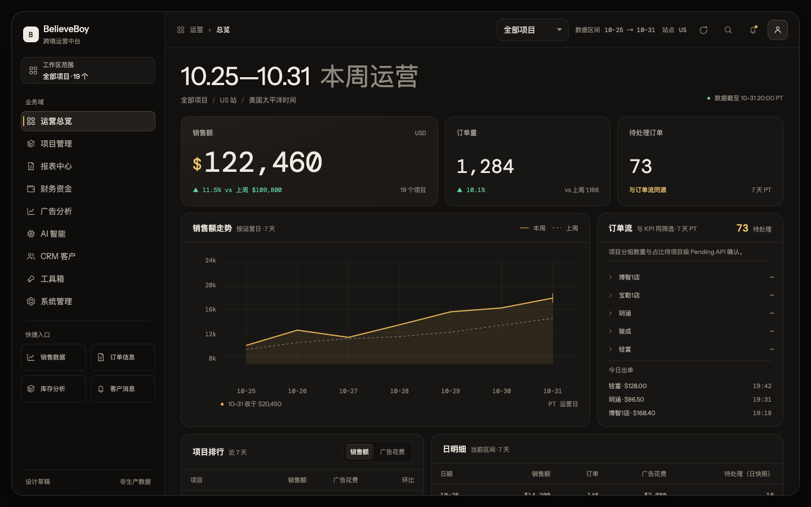
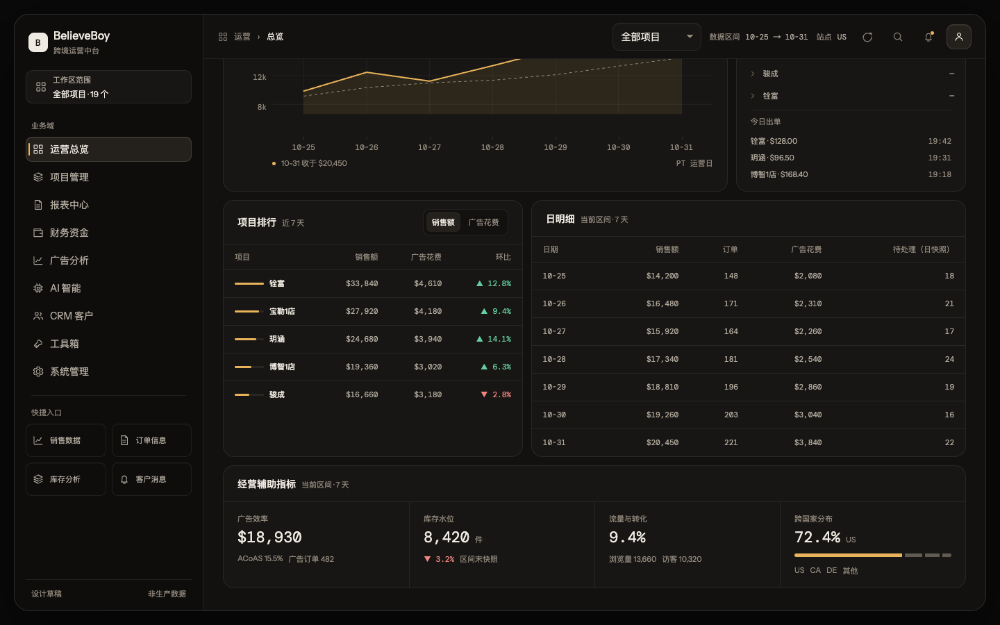
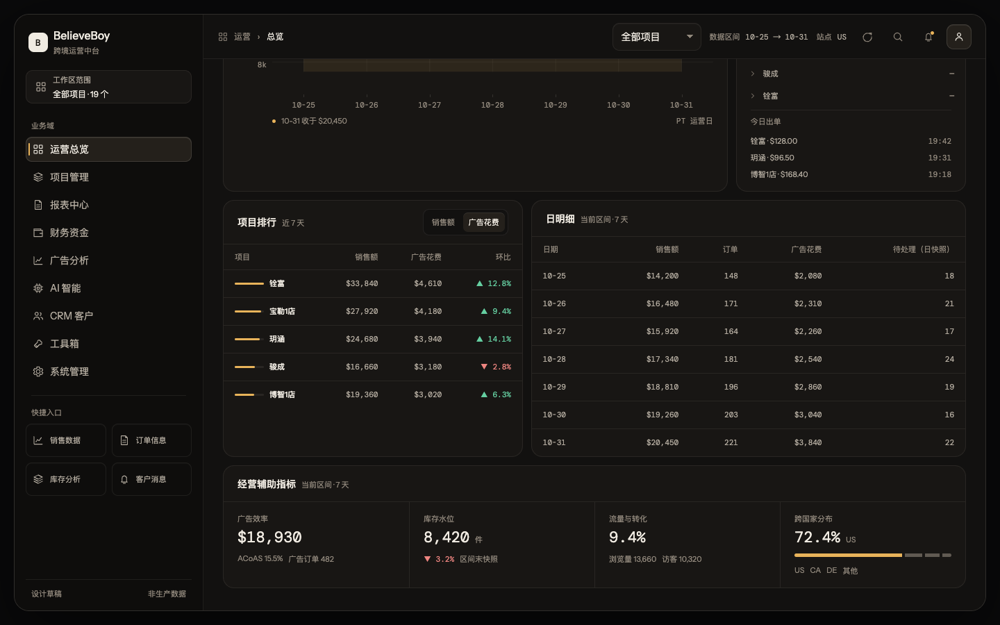
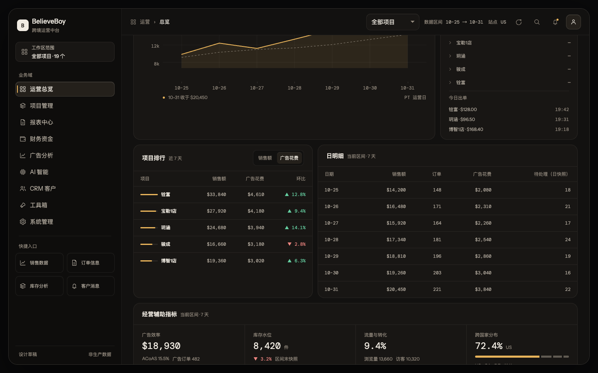
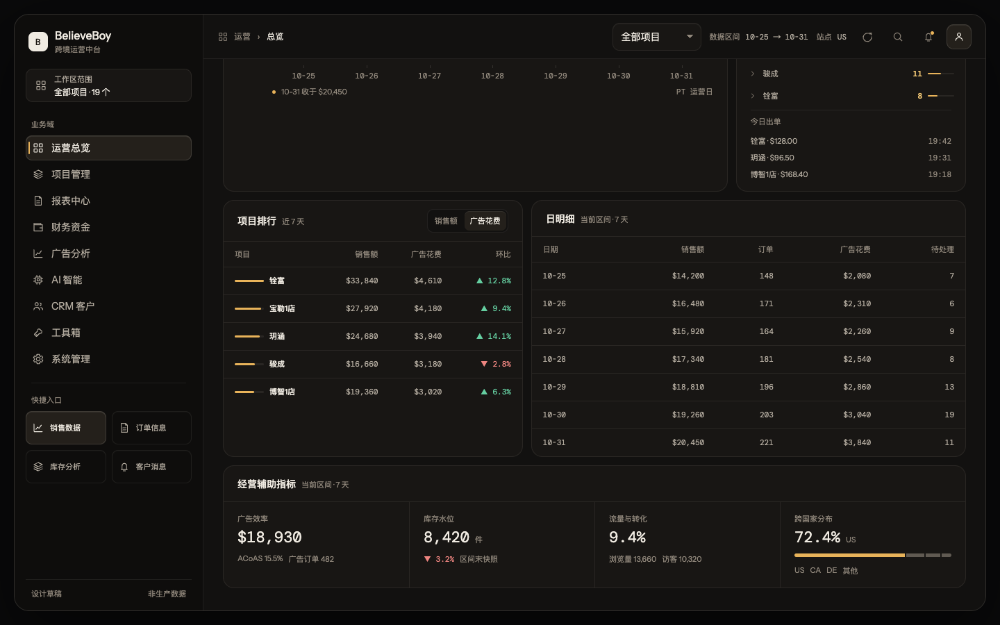
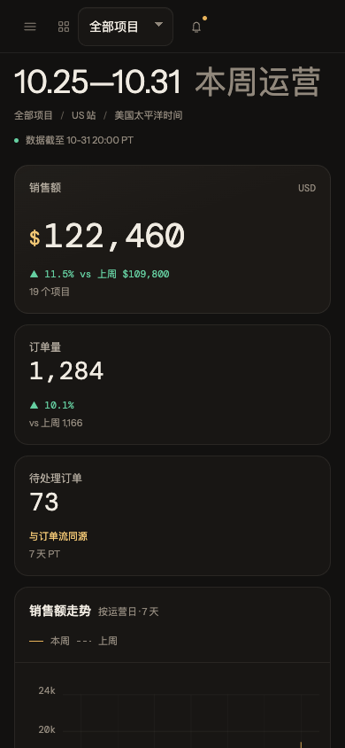
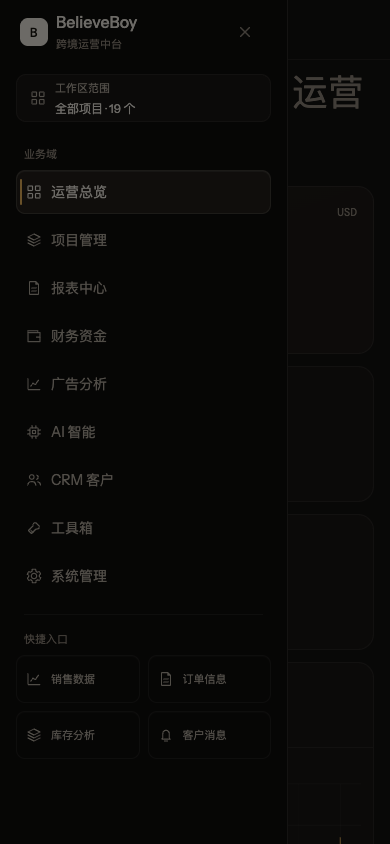
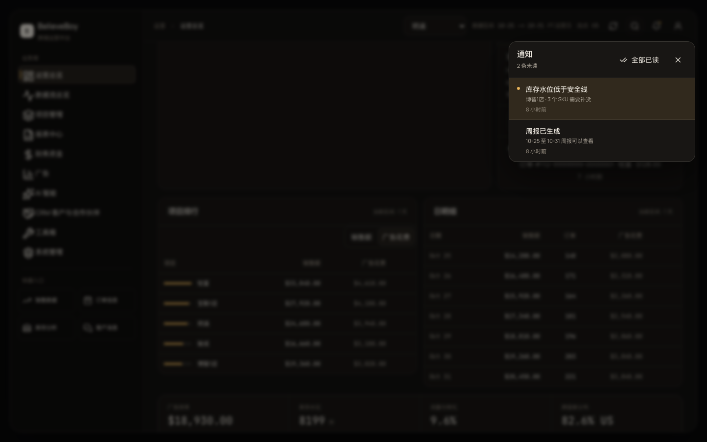

# BelieveBoy 运营总览设计草稿

> 状态：设计已确认，并已于 2026-11-01 在精确 `/dashboard` 路由实施；本文同时作为后续类目推广的设计基准。
>
> 范围：`/dashboard` 首页的工作区、导航呈现、筛选、指标、图表、项目排行、订单流和日明细。
>
> 输入草稿：`/Users/damon/DamonProjects/believeboyDev/dashboard-draft/index.html`
>
> 审阅记录：[review.md](./review.md)
>
> 下一阶段组件批次：[components/plan.md](./components/plan.md)

## 1. 这一版是什么

这一版沿用输入草稿的几个视觉起点：深色工作窗、272px 单侧栏、大号周期标题、非等宽指标卡、等宽数字、克制的图表。

但它不复刻草稿里的“Sable / Cash flow / 银行卡 / 逾期账单”业务模型。真实产品是跨境电商多品牌运营中台，首页的核心任务是：

1. 先看本周边界的销售额、订单量和 Pending。
2. 判断本周走势是否健康。
3. 找到贡献最大的项目和需要处理的订单。
4. 下钻到日明细。

本稿提出一套路由级设计语言，暂称 **Warm Operations Ledger**：

- 暖灰石墨表面，而不是冷黑终端；
- 琥珀色作为唯一数据强调色；
- 圆角面板和工作窗替代 V3 的零圆角外壳；
- 通过排版、曲线和行列节奏制造“运营账本”感，不靠发光、玻璃或渐变大标题；
- 所有数字、日期和金额用等宽字体与同一格式。

这套语言有意不沿用当前 V3 Terminal 的零圆角、1px 全平铺和双层 rail/subnav 结构。若进入正式工程，建议作为 `/dashboard` 路由级例外评审，不要直接改全站 token。

Damon 已确认采用 Warm Ledger 的整页方向：保留经营辅助指标 `DiagnosticStrip`、项目排行排序、订单分组默认收起；首版深色-only，浅色主题延期。该确认记录的是整页视觉与交互方向，不等于批准 `/dashboard` 的导航入口、生产开关或 shell 例外。

## 2. 原草稿审计

| 位置 | 问题 | 本稿处理 |
| --- | --- | --- |
| 品牌与标题 | `Sable`、`Cash flow` 与 BelieveBoy 无关 | 换成 BelieveBoy、本周运营、真实项目与 US 站口径 |
| 主导航 | Overview / Inbox / Projects / Customers / Invoices / Reports 是通用 SaaS 模型 | 改为真实 9 个业务域与运营快捷入口 |
| Plans | Enterprise / Business / Pro / Starter / Free 是虚构客户计划 | 删除，替换为销售数据、订单信息、库存分析、客户消息 |
| Payment card stack | 银行卡与产品数据无对应关系，是装饰性物件 | 删除，主视觉交给真实销售额曲线 |
| 指标 | Paid this month / Overdue / Outstanding 不对应首页接口 | 改为销售额、订单量、Pending；广告花费进入辅助指标带 |
| 图表 | 四条彩虹系列 + glow + mirrored lines，颜色没有业务含义 | 当前周 vs 上周两条线；当前周用琥珀，历史周用灰色虚线 |
| 页头状态 | `Synced 2m ago` 没有真实数据源 | 改为“数据截至 10-31 20:00 PT”，与接口日期对齐 |
| 文案 | 多处大写、宽字距英文标签和泛化副标题 | 中文界面、句首大小写、仅金额代码用 mono |
| 表面 | 径向渐变舞台、重阴影与多层近黑表面 | 保留工作窗层次，去掉径向色洗和图表发光 |
| 数据一致性 | 各指标之间无法按字段口径核对 | 销售额、订单量等可加总字段分别对账；Pending count 与日快照明确分开，不互相求和 |

## 3. 设计方向

### Product

面向多品牌跨境电商运营人员的一周经营总览，用于判断销售走势、项目贡献和待处理订单。

### Character

`warm, operational, exact`

它不是“酷炫数据大屏”，也不是“泛 SaaS 后台”。它更像凌晨仍有人值守的运营桌面：安静、有温度、数字必须可信。

### World

航运清单、运营账本、交班记录。表面取暖灰石墨色，强调色取运单标记常见的琥珀黄。

### Moments

1. **本周销售额曲线**：屏幕唯一持续发亮的对象，琥珀线 + 同色低透明度面积。
2. **Pending 的项目分布**：若项目级 Pending API 确认提供完整总数，右侧订单流可用琥珀细横条表达；确认前不显示项目数量或占比。

### Signature

所有日期、时间戳和图表轴都明确带 **PT 运营日**。它把“美国站、昨日终点、7 天窗口”这个业务口径变成可见的产品细节。

## 4. 信息架构

### 4.1 左侧栏

- 品牌：`BelieveBoy`，平面字母 B，不做渐变或发光。
- 当前范围：`全部项目 · 19 个`。
- 业务域：运营总览、项目管理、报表中心、财务资金、广告分析、AI 智能、CRM 客户、工具箱、系统管理。
- 快捷入口：销售数据、订单信息、库存分析、客户消息。
- 底部：同步状态、PT 时间。

单侧栏替代当前 rail + subnav。优点是一次扫描即可看到业务域，缺点是会牺牲“域内二级导航”的常驻性；因此本稿只把最高频的 4 个运营入口放进快捷区。

### 4.2 顶栏

从左到右：

- 面包屑：运营 / 总览。
- 项目筛选：全部项目或单项目。
- 数据区间：固定 7 天，展示 `10-25 → 10-31`。
- 站点：US。
- 刷新、搜索、通知、用户。

区间和站点是口径说明，不伪装成可点击筛选器。当前接口固定美国站与 7 天窗口，见 `frontend/app/dashboard/page.tsx:175` 与 `frontend/app/dashboard/page.tsx:233`。

### 4.3 页面主体

1. **周期标题**：`10.25—10.31 本周运营`。
2. **关键指标**：销售额占主要宽度，订单量与 Pending 两张窄卡。
3. **销售曲线 + 订单流**：趋势与可执行队列并排。
4. **项目排行 + 日明细**：先看贡献，再看逐日来源。
5. **经营辅助指标**：保留 `DiagnosticStrip`，把广告效率、库存水位、流量转化、跨国家分布收进一条横向诊断带，不再各占一张同权重图表。

订单流没有放进右侧 Inspector，因为它是首页的主任务之一，不是辅助上下文。项目排行和日明细放在首屏下方，承接自然下钻。

底部不再保留数据滚动条或状态栏，主内容区直接占满工作窗剩余高度。

## 5. 数据映射

| 界面元素 | 真实字段 / 来源 | 计算或展示规则 |
| --- | --- | --- |
| 销售额 | `summary_rows[].sales_amount` | 当前 7 天求和；与上一 7 天求和比较 |
| 订单量 | `summary_rows[].order_qty` | 当前 7 天求和；与上一周期比较 |
| 待处理订单 KPI | 待处理订单 count/list API | 与订单流 headline 共用同一个 count/list 数据源、项目筛选和 7 天 PT 日期范围；展开列表的 `total` 必须匹配 count 总数 |
| 销售曲线 | `summary_rows[].date` + `sales_amount` | 当前周实线，上一周虚线 |
| 项目排行 | `project_breakdown[projectId].summary_rows` | 按项目汇总销售额；环比取上一周期同项目汇总 |
| 订单流 headline | 待处理订单 count/list API | 收起时读取 count，展开时读取同一筛选下的列表 `total`；项目筛选与 KPI 一致，日期为同一 7 天 PT 窗口 |
| 项目待处理分组 | 待 Damon 确认的项目级 Pending API | 只有接口提供完整项目总数，或订单列表已完整时才展示项目 count / 占比；不得从日快照或已加载的部分分页推算 |
| 今日出单 | `useLiveStream()` | 项目、金额、时间；不在首页伪造订单详情 |
| 日明细 | `summary_rows` | 日期、销售额、订单量、广告花费、`pending_order_qty` 日快照；表头标为“待处理（日快照）” |
| 广告效率 | `ad_spend` / `sales_amount` / `ad_orders` | 广告花费、ACoAS、广告订单汇总 |
| 库存水位 | `summary_rows[].available_qty` | 取区间末快照；与上一周期末比较 |
| 流量与转化 | `page_views` / `sessions` / `units_ordered` | 转化率 = `units_ordered / page_views` |
| 跨国家分布 | `/all-projects-countries` 或 `/all-countries` 的 `country_breakdown` | 按站点销售额排序，用一条堆叠比例条表达份额 |
| 数据新鲜度 | 最新 `summary_rows[].date` | 展示最新数据日与 PT 时间 |
| ACoAS | `sum(ad_spend) / sum(sales_amount)` | 只进入经营辅助指标带，不单独占用底栏 |

字段来源：

- 行结构：`frontend/app/dashboard/page.tsx:107`
- 指标聚合：`frontend/components/dashboard-v2/v2-stats.tsx:46`
- 项目排行：`frontend/components/dashboard-v2/v2-top-projects.tsx:52`
- 订单流项目分解：`frontend/components/dashboard-v2/v2-order-flow-panel.tsx:175`
- 真实导航：`frontend/lib/sidebar-config.ts:135`

### 5.1 示意数据

HTML 中的数据用于验证字段、排序、留白和首屏阅读，不是线上实时值。销售额、订单量、广告花费等区间示意值可对账；Pending 使用独立的数据口径：

- 5 个项目销售额合计：`$122,460`
- 5 个项目订单合计：`1,284`
- 7 天销售额合计：`$122,460`
- 7 天订单合计：`1,284`
- 7 天广告花费合计：`$18,930`
- 待处理 KPI 与订单流 headline：count API 在当前项目筛选及 `10-25 → 10-31 PT` 范围内返回的示意总数 `73`；这不是日快照之和。
- 日明细 Pending 列为逐日快照，示意值与 `73` 无加总关系，也不作为 KPI 或订单流的回退值。
- 订单分组的项目级数量和占比在项目级 Pending API 确认前不展示为已知值。
- ACoAS：`$18,930 / $122,460 = 15.5%`
- 辅助带中的库存、流量与国家份额同样是示意值，只用于检验信息密度和布局。

项目名称取自本地 `projects` 表的真实对象；金额、时间与订单号是版式示意。正式页面不得显示此示意数据。

## 6. 视觉系统

### 6.1 色彩

| 角色 | 值 | 用途 |
| --- | --- | --- |
| Stage | `#09090a` | 工作窗外背景 |
| Window | `#121110` | 主工作区 |
| Sidebar | `#0e0d0c` | 主导航 |
| Panel | `#181614` | 指标卡与内容面板 |
| Raised | `#24201b` | 选中、悬停、用户块 |
| Text | `#f0ebe2` | 主文本 |
| Soft | `#b2aa9e` | 次要文本 |
| Muted | `#7e766b` | 标签、辅助信息 |
| Accent | `#e8b35a` | 当前曲线、Pending、主要强调 |
| Accent strong | `#f3c875` | 货币符号、关键数字 |
| Positive | `#65cfa1` | 增长、健康 |
| Negative | `#ee8580` | 下降、异常 |

约束：

- 不使用紫色、蓝色霓虹、彩色 glow 或渐变文字。
- 琥珀只用于当前曲线、Pending、金额符号和选中状态。
- 正负色只表达涨跌，不拿来做装饰。

### 6.2 字体

- 界面：Instrument Sans。
- 数字、日期、金额、代码：DM Mono。
- 中文回退：PingFang SC → Microsoft YaHei → Noto Sans SC。
- 页面标题 44px / 400；窄屏的 38px、40px、36px 标题均使用 `letter-spacing: 0`。
- 指标主值 50px / 400。
- 次指标 34px / 400。
- 界面正文 12–14px / 400–500。
- 不使用 700–900 字重，不使用小字号负字距。

### 6.3 间距与圆角

- 间距基线：4px。
- 内容边距：28px。
- 卡片内边距：20px。
- 卡片间距：12px。
- 控件高度：34–38px。
- 工作窗圆角：22px。
- 面板圆角：16px。
- 控件圆角：10px。
- 内部元素圆角只取 8px 或更小，满足嵌套圆角关系。

### 6.4 图标

- 单一内联 line icon 集。
- 18px，stroke 1.55。
- 图标颜色跟随文本层级。
- 不使用 emoji、Sparkles 作为 AI 图标或强制彩色图标。

## 7. Unslop 九轮处理

### 7.1 Spacing

- 统一 4px 节奏。
- 指标卡同高度；三张卡内边距一致。
- 页头、指标、主图表、下钻区之间有明确层级：同组 8–12px，模块间 16–24px。
- 图表和订单卡底部对齐，避免右侧内容把左侧撑出无意义空白。

### 7.2 Color

- 去掉原草稿的径向渐变舞台。
- 表面改成暖灰石墨单色阶。
- 以琥珀为唯一强调色；正负色只承载语义。
- 图表无 glow，只有一条实线、一条虚线和一块 10% 面积填充。

### 7.3 Icons

- 原草稿的通用 SaaS 图标替换为真实业务域图标。
- AI 从 Sparkles 改为芯片轮廓，避免“AI=闪光”的陈词。
- 所有图标同尺寸、同 stroke、同文本色。

### 7.4 Copy

- 删除 “Cash flow across all connected accounts” 这类泛化副标题。
- 页面只显示用户需要判断的口径：项目、站点、PT、日期、数据新鲜度。
- 所有变化都带比较对象，如 `vs 上周`。
- 不出现问候语、感叹号、营销词或无法验证的 claim。

### 7.5 Type

- 采用单一界面字体 + 单一数字字体。
- 标题层级主要由尺寸和颜色决定。
- 金额、日期、订单量统一 mono。
- 去除宽字距全大写标签；`USD`、`ORD`、`PND` 只作为紧凑字段代码。

### 7.6 Layout

- 保留草稿的 272px 单侧栏和工作窗构图。
- 指标改为非对称：销售额主卡 + 两张窄卡。
- 主图表占主要宽度，订单流是窄列表，不制造第二个同权重图表。
- 下钻区是排名和日表；广告、库存、流量、国家分布收进一条诊断带，不再堆 4 张同形图表。

### 7.7 Details

- 项目排行用 42px 细条 + 项目名 + 金额，不加入迷你趋势图。
- 订单流只加表示项目占比的细条，不将每行做成 pill。
- 当前曲线右侧有一根 1px 收尾线，表达最后运营日。
- `PT 运营日` 是本设计的签名细节。
- 菜单、图标按钮、筛选器和排序控件增加表面抬升、1px 边框和顶部内高光；按压时只下移 1px，不使用外发光或彩色阴影。
- 当前导航用左侧 2px 琥珀标尺 + raised surface 表达激活，不只依赖文字颜色。

### 7.8 Visuals

- 不使用生成图片，不引入银行卡、地图、货轮等具象插画。
- 产品的视觉资产来自真实曲线、真实项目列表和实时订单流。
- 深色窗口就是产品世界，不需要额外场景图。

### 7.9 Motion

- 工作窗进入：一次 520ms fade + 10px 上移。
- 页面内不再叠加第二组入场，避免“窗口和内容各动一次”。
- hover 只改变背景色或边框色。
- 不使用 pulse、floating、scale-up、glow 或 transition-all。
- 遵循 `prefers-reduced-motion`。

## 8. 响应式

### ≥1241px

- 272px 侧栏。
- 三列指标。
- 图表 + 订单流并排。
- 项目排行 + 日明细并排。

### 1051–1240px

- 侧栏收为 88px 图标列。
- 销售额主卡换到第一行整宽。
- 图表和订单流仍并排，但降低订单列宽。

### 821–1050px

- 指标变两列。
- 主图表和订单流上下堆叠。
- 项目排行和日明细上下堆叠。
- 经营辅助指标变两列。

### ≤820px

- 工作窗铺满视口，去掉圆角和外阴影。
- 侧栏变为左侧抽屉，内含完整业务域和快捷入口。
- 顶栏 sticky，保留项目筛选和通知。
- IconButton、ProjectSelect、SortControl、NavItem、OrderGroup summary 的触控区域至少 44px。
- 指标、图表、订单流、表格按阅读顺序堆叠。
- 经营辅助指标单列排列。
- 表格允许横向滚动，不压缩列文字。

### ≤460px

- 指标改为单列。
- 标题 36px，且无负字距。
- 次要顶部控件隐藏，保留菜单、项目筛选和通知。
- 卡片脚注可换行，避免金额与比较对象互相挤压。

## 9. 状态设计

### Loading

- 指标卡用与外框同形状的 skeleton，不使用 spinner 作为主反馈。
- 曲线区保留标题和图例，图体显示静态骨架。
- 订单流显示“正在读取待处理订单”并保留计数区宽度。

### Empty

- 主数据为空：文案“当前区间暂无销售数据”，提供“切换到上周”与“刷新”两个动作。
- 项目排行为空：只显示“当前筛选没有项目数据”，不出现假柱条。
- 订单流为空：显示“当前没有待处理订单”，不保留 73 这类假计数。

### Error

- 主数据失败：在页面级提示“销售数据加载失败”，保留筛选，提供“重试”。
- 跨国家数据失败：静默降级，不遮挡主指标，与现有实现一致。
- 项目列表失败：顶栏筛选显示“项目加载失败”，提供重试。

## 10. 交互

| 动作 | 反馈 |
| --- | --- |
| 切换项目 | 首页所有指标、曲线、排行、订单流、日明细同步刷新 |
| 刷新 | 按钮进入 loading，完成后给屏幕阅读器状态 |
| 排序项目 | Damon 已确认保留“销售额 / 广告花费”切换与动态重排 |
| 点击项目排行 | 下钻到销售数据页，并携带项目与 US 站点；日期沿用该页默认窗口 |
| 点击订单流项目 | 在项目级 Pending API 确认并返回完整项目范围后，跳转订单信息页并筛选 Pending、项目和日期 |
| 点击今日出单 | 跳转对应订单信息，不把整行做成假按钮 |
| 移动端导航 | 左侧抽屉，Esc / 点遮罩关闭；跨到桌面时焦点转到 workspace，桌面跨到移动端且焦点在 sidebar 时转到 menu button |

## 11. 可访问性

- 所有交互元素有可见 focus ring。
- 项目筛选有显式 label。
- 图表有文字 aria-label 概括趋势与首尾值。
- 订单流用列表语义；若加入可展开订单，使用 button + aria-expanded。
- 颜色不是唯一语义：涨跌同时有箭头与正负号。
- 正文对比度不低于 4.5:1；Muted 只用于辅助文字。
- 动效遵循 reduced motion。

## 12. 与现有代码的落地边界

本稿最初是独立 HTML；当前 `/dashboard` 已按以下边界落地，HTML 继续作为视觉基准与回归对照。

若进入正式实现，建议按以下边界拆分：

1. `dashboard-home-shell`：路由级新外壳，保留现有 `/api/v1/projects/manage` 与筛选逻辑。
2. `MetricStrip`：从 `computeStats()` 读取数据，不再新增接口。
3. `SalesTrendPanel`：消费现有 `currentRows` / `comparisonRows`。
4. `OrderFlowPanel`：保留现有 pending count/list 与 live stream 数据源。
5. `ProjectRankTable`：沿用 `computeTopProjects()`，新样式替换 TermChartCard。
6. `DailyLedgerTable`：沿用 `DailyAnalysisTable` 行结构，但重新设计表头与行高。

批次约定：A1 拥有 Warm controls wrapper（Button、IconButton、ProjectSelect、FilterControl、SortControl、Badge、Input）及 token 在 Dashboard 实现中的使用；A2–A5 只消费这些控件，不另建同类控件。跨组件共享 props 类型由 A6 定义并接线。`components/foundations/` 四个文件是 A0 冻结输入，A1–A5 只读。

不要：

- 不要为了本稿改全局 `--term-*` token；
- 不要同时保留 V3 零圆角和新稿圆角；
- 不要先造空组件或假接口；
- 不要把示意数据接入生产。

## 13. 预览

## 14. 待确认

已由 Damon 确认：Warm Ledger 整页方向、保留 `DiagnosticStrip`、保留项目排序、订单分组默认收起、首版深色-only；浅色主题延期。7 天 PT 日期口径用于 KPI、订单流和日明细。

G0 已关闭：

1. 新增“运营总览” → `/dashboard`，保留“数据流总览”；快捷入口使用销售数据、订单信息、库存分析、客户消息。
2. 生产直接使用新设计，不设 feature flag；回滚走正常代码回滚。
3. 项目级 Pending 分布暂不展示，直到存在完整的 API-backed 项目总数。
4. 精确 `/dashboard` 旁路 `TerminalShell`；首页数据层已抽到 `useDashboardHomeData()`。

## 15. 生产验证

- 真实生产构建浏览器检查：1440×900、1280×720、1280×600、1024×768、821×720、820×720、390×844、320×568。
- 所有视口无页面级横向溢出；桌面不出现移动菜单 / 抽屉关闭按钮。
- 移动抽屉已验证 `aria-expanded`、`aria-hidden`、Esc、焦点进入关闭按钮与关闭后返回菜单按钮。
- 已验证项目筛选联动 5 类数据请求、项目排序、刷新、全局搜索、通知、个人资料入口、项目排行下钻和订单跳转参数。
- 真实生产截图见 `assets/production-dashboard-*.png`；本地 Vercel Analytics / Speed Insights 404 不计为产品错误。
- `pnpm test`：295 files / 2308 tests；`pnpm build`、目标 ESLint、`git diff --check` 通过。

## 16. Attribution

本稿的细节打磨遵循 unslop by Damir Sokolovsky（[@heydamir](https://x.com/heydamir)，[heydamir.design/unslop](https://heydamir.design/unslop)），CC BY 4.0。方向来自 BelieveBoy 的真实业务和输入草稿，不复制 unslop 示例主题。
