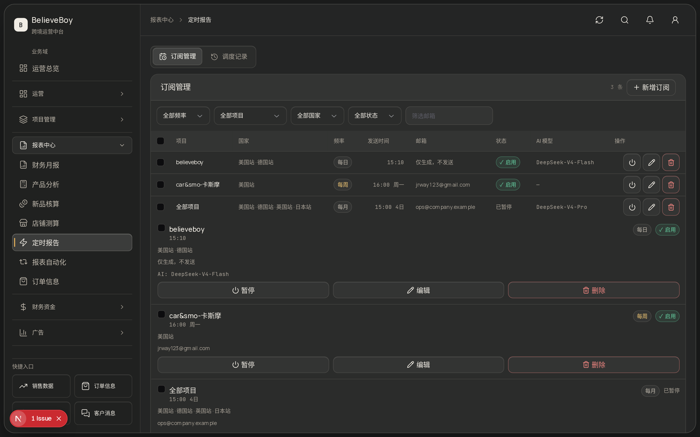
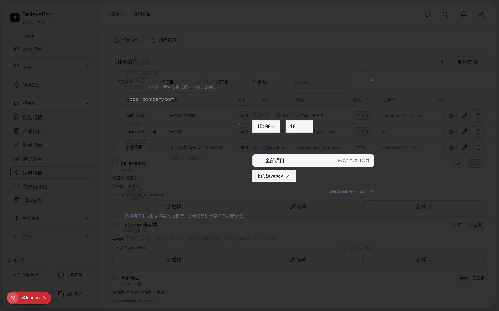

# 定时报告 · 订阅管理 / 订阅记录 / 编辑订阅 重设计（2026-11-18）

> 状态：设计草稿，方案 A 已由主 Agent 评审通过作为实现基准；方案 B 作为备选保留。未改任何 `frontend/` 业务代码，未 commit。
>
> 范围：`frontend/app/dashboard/reports/scheduled-reports/`（路由 `/dashboard/reports/scheduled-reports`、`/subscriptions`、`/ledger`）的桌面重设计，桌面验收视口 `1440×900`。
>
> 依据：`frontend/docs/design-spec.md` §0.4、`docs/design-drafts/2026-11-01-operations-dashboard/components/foundations/spec.md`、`frontend/components/dashboard-v2/warm-ledger/shell/theme.css`、`controls/warm-controls.tsx`，以及现有 `SubscriptionsView.tsx` / `LedgerView.tsx` / `SubscriptionForm.tsx` / `EditSubscriptionDialog.tsx`。
>
> 页面内业务数值均为**示例数据**，每张页面都在可见位置标注「示例数据」；字段全部对应真实接口字段，文案来源见第 3 节。

---

## 1. 文件清单

| 路径 | 说明 |
| --- | --- |
| [index.html](./index.html) | 两个方案与现状证据的导航页 |
| `plan-a/subscriptions-dark.html` / `-light.html` | 方案 A · 订阅管理 |
| `plan-a/ledger-dark.html` / `-light.html` | 方案 A · 订阅记录（路由仍为 `/ledger`） |
| `plan-a/edit-dialog-dark.html` / `-light.html` | 方案 A · 编辑订阅弹窗（含「邮箱格式无效」校验态） |
| `plan-a/states-dark.html` / `-light.html` | 方案 A · 状态与边界走查（加载/空/错误/筛选空/只读/长内容） |
| `plan-b/subscriptions-dark.html` / `-light.html` | 方案 B · 按收件人分组的订阅管理 |
| `plan-b/ledger-dark.html` / `-light.html` | 方案 B · 按订阅分组的订阅记录（失败优先） |
| `plan-b/edit-dialog-dark.html` / `-light.html` | 方案 B · 双栏变更摘要弹窗 |
| `assets/shots/*.png` | 本轮 1440×900 渲染截图（15 张，见第 11 节） |
| `assets/before/*.png` | 主 Agent 在真实环境截取的现状证据（2 张，见第 8 节） |

全部 HTML 为 standalone：无构建、无 JS、无本地依赖；仅可选加载 Google Fonts（Instrument Sans / DM Mono），离线时回退到系统中英文栈，不影响布局与对比度。

---

## 2. 用户任务

1. **订阅管理**：运营/管理员查看与维护所有定时报告订阅——它把哪份报告（项目/国家）在什么时候（频率/星期/日期/北京时间）发到哪个邮箱（或只生成不发送）；能启用/暂停、编辑、删除、批量暂停/启用/改模型/删除；能按邮箱、启用状态、频率、国家、项目筛选。需要处理 20+ 条订阅的扫描、比较与批量操作。
2. **订阅记录**（用户命名，原页面标题「调度记录」）：按日期查看每一次应发的报告，判断是否已发送/已生成/失败/缺失/处理中；查看项目、邮箱、截图缩略图、AI 摘要；能看详情、重新生成（**不发送邮件**）、生成 AI 摘要；能按日期范围、状态、频率、邮箱、项目筛选；看到当前范围的汇总数字；长列表按天分页。
3. **编辑订阅弹窗**：在暗色/浅色下都能清楚读到标签、值、帮助与错误；按「接收 / 范围 / 调度 / 模型」分区；底部操作固定、内容区内部滚动；键盘焦点顺序可预期；不再出现深底深字或浅底浅字。

---

## 3. 真实数据与文案来源

### 3.1 字段来源

- 订阅：`frontend/app/dashboard/reports/scheduled-reports/_components/types.ts` 的 `Subscription`，与 `backend-go/internal/api/scheduled_reports/types.go` 的 `Subscription` 一致。`email` 可空；`project_ids` 为 `"*"` 或逗号分隔的正整数 ID；`country` 为逗号分隔站点码；`frequency` 为 `daily/weekly/monthly`；`dispatch_hour/minute` 为北京时间；`dispatch_weekday` 0=周一；`dispatch_day` 2–28；`ai_model` 可空；`enabled` 为布尔。
- 订阅记录：`LedgerItem` 与 `LedgerListResponse`。`status` 只可能是 `sent/failed/missing`；`summary` 为 `expected/sent/failed/missing/resendable`；`project_names` 由后端解析；`screenshot_r2_thumb_url` 为缩略图签名地址；`ai_summary_status` 为 `pending/generating/done/failed`；`can_resend` 为 true 表示该状态允许重新生成（failed/missing，以及 `sent` 但 `email_sent=false` 的生成型记录）；它不是权限位。
- 分页口径：GET `/api/v1/scheduled-reports/ledger` 的 `limit` 解释为**最近多少天**（store 先取 `distinct expected_date` 再取当天全部行），`offset` 为**天偏移**，`total` 为**记录行数**不是天数。因此本稿不做页码分页，而用「日期范围 + 查看更早 7 天」。
- 项目筛选项：Go handler 已支持 `project_id` 查询参数（`GetLedger`），现有前端 `api.ts` 未传；本稿按已支持的契约设计，实施时补参数即可。
- 时区：`Asia/Shanghai`（`SCHEDULED_REPORTS_INFRASTRUCTURE.md` 明确「北京时间作为标准时区」，store 用 `Asia/Shanghai` 生成 ledger 日期）。页面在表头/工具条显式标注「北京时间」。
- 权限：订阅写操作按 `roleType === 'admin' || 'operator'`；订阅记录的重新生成入口按 `isAdmin`（`LedgerView.tsx`），`can_resend` 表示状态资格（failed/missing/生成型），不是权限位。本稿的只读态按此实现。

### 3.2 校验与错误文案

直接复用 Go `validation.go` 的原文，避免自拟：

| 场景 | 文案（后端原文） |
| --- | --- |
| 邮箱缺少/多个 `@` | 邮箱格式无效（需包含且仅包含一个 @） |
| 用户名或域名不完整 / 域名无 `.` | 邮箱格式无效（用户名或域名不完整） |
| 邮箱超长 | email 长度不能超过 256 |
| 周一早于 16:00 | 周报最早可在周一 16:00 发送 |
| 项目 ID 非法 | project_ids 必须是 '*' 或逗号分隔的正整数 ID |
| 国家为空 | 后端回退 `US`；UI 约束至少保留 1 个站点（不在 UI 报错） |

### 3.3 复用现有 UI 文案

新增订阅、编辑、删除、暂停、启用、重试、暂无订阅配置、筛选邮箱、北京时间、已选 N 个项目合并、清空选择、生成摘要、详情、AI 摘要、新增订阅、只读。

### 3.4 本稿新增/变更的产品文案

| 文案 | 来源 / 理由 |
| --- | --- |
| **订阅记录** | 用户明确用词；路由 `/ledger` 不变。替换页面标题、tab、面包屑 |
| **仅生成，不发送** | `email === null` 的真实语义；替换现有「未填写/未填写邮箱」 |
| **重新生成** | 后端已定：重新生成永不发送邮件，无论是否有邮箱；替换「补发」，避免误导 |
| **可重新生成** | `summary.resendable`（失败+缺失）的中文标签；替换「可补发」 |
| **已完成含「仅生成」** | `summary.sent` 含无邮箱生成条目；在汇总条可见位置说明，避免把 16 误读为 16 封邮件 |
| **处理中** | 重发/重新生成进行中的瞬时状态（前端轮询 delivery stage；不落库、不是 `ledger.status`） |
| **只读** | 当前账号无写权限时的能力态 |

---

## 4. 设计决定（按 design-spec §0.4.4）

1. **用户任务与数据来源**：见第 2、3 节；所有可见字段来自 `Subscription` / `LedgerItem` / `LedgerSummary`，不引入自造指标。页面唯一派生数字是「共 N 条」「已选 N 条」与行内「+N」截断提示。
2. **对齐的 Warm Ledger 页面**：
   - `/dashboard`（B0）：工作窗、280px 侧栏、8px 外沿、Panel/Header 节奏、单一琥珀强调；
   - `/dashboard/operations/inventory-ledger`：日期范围 + 密排账本表格 + 页内 tab 的既有模式；
   - `/dashboard/reports/order-info`：宽表 + 顶部筛选带的密度与表头处理；
   - 现有 `/dashboard/reports/scheduled-reports`：保留 46px tablist 与 Panel header，但重构内部表格与弹窗。
   - 不沿用 V3 Terminal：不使用 `--term-*`、零圆角、1px 全平铺；dialog 不继承 `bg-term-panel text-term-text`。
3. **唯一视觉与操作主角**：
   - **订阅管理**：每行的「接收」块（邮箱或「仅生成，不发送」）。用户反馈的核心是“看不清发到哪/有时不发”，所以接收状态用正文 13px 的 mono 邮箱或明确的状态文本承载；项目、国家、调度退为两行辅助。全页只有主按钮与选中态使用强调色，开关轨道改为中性填充，不再出现一列琥珀开关。
   - **订阅记录**：**日账头**（日期 + 星期 + 今天 + 当天计数）是视觉骨架；行内状态用「符号 + 文字」承载，AI 摘要与截图作为次级证据。汇总条是安静的 mono 数字，不做大号 KPI 卡。
   - **编辑弹窗**：表单分区本身是主角，没有 hero、没有配置预览条、没有假“已校验”绿勾；第一焦点是接收邮箱。
4. **桌面布局**（`1440×900`）：stage 8px 外沿 → 工作窗 `1424×884`、圆角 22、1px 强边界；侧栏 280；顶栏 64；内容 20px 内边距；tablist 46 + 12 间距；面板头 54、工具条 56、批量条 52、表头 44/48、行 60（订阅）/56（记录）；弹窗 780（A）/980（B），最大高度 `100vh-56px`，内部滚动、底栏固定。
5. **复用 token 与控件**：只用 `--warm-ledger-*`；复制真实色值（暗色 B0 + 浅色 2026-11-10 扩展）。控件几何沿用 Warm：按钮 36/38、图标按钮 36、Select 40、焦点 2px + 3px offset。页面本地样式用 `--sr-text-aux`（12px）、`--sr-text-cell`（13px）别名，正文 14、分区标题 16、弹窗标题 20。
6. **状态**：loading/empty/error/permission/filtered-empty/long-content 全部有独立形态；见第 9、10 节。
7. **动效**：仅窗口入场 520ms fade + 10px（沿用 foundations），控件 140ms，按压 100ms + 1px；弹窗 220ms fade + 8px；`prefers-reduced-motion` 全部关闭。无 pulse、glow、bounce、`transition: all`。

---

## 5. 信息架构

### 5.1 方案 A（主方案，推荐）

**共用**：46px tablist「订阅管理 / 订阅记录」；面包屑「报表中心 › 定时报告 › 订阅管理/订阅记录」。tab 是页面内视图切换（现有实现即路由 + 状态式 tab），路由不变。

**订阅管理（A）**

```
Panel header: 订阅管理 | 示例数据 · 共 12 条 | 新增订阅(primary)
Toolbar: [全部|启用|已暂停|仅生成] [频率] [国家] [项目] [筛选邮箱] —— 重置
Selection bar（选中时出现）: 已选 N 条 | 模型下拉 · 应用模型 · 暂停 · 启用 · 删除 | 清空选择
Table (sticky header, internal scroll)
  ☐ | 项目(+国家) | 调度(+北京时间) | 接收 | AI 模型 | 状态(开关+文字) | 操作
```

7 个内容列（外加选择列，共 8 列；现状 9 列）：把「国家」并入项目副行，把「频率」并入调度副行，减少单行截断压力，同时保留完整信息。邮箱为一行 mono；空值显示「仅生成，不发送」。表头 `调度` 的第二行固定标注「北京时间」。

**订阅记录（A）**

```
Panel header: 订阅记录 | 示例数据 · 共 21 条
Toolbar: 日期范围(mono) | 状态 | 频率 | 项目 | 筛选邮箱 | 时间均为北京时间
Summary strip: 应发 21 · 已完成 16 · 失败 2 · 缺失 3 · 可重新生成 5 | 已完成含「仅生成」
Table (sticky header): 时间 | 项目(+国家) | 接收 | 状态 | AI 摘要(2 行) | 截图 | 操作
  Day row (44px): 2026-11-18 周三 今天 | 4 条 · 已完成 3 · 失败 1
  Entries (56px): 09:30 | believeboy / 美国站 | ops@company.example | ✓ 已发送 | 摘要 | 缩略图 | 详情 · 重新生成
Footer: 已显示 11-12 至 11-18 · 7 天 · 21 条记录 | 查看更早 7 天（offset 按天）
```

日头是折叠开关（`aria-expanded`）。状态与操作一一对应：已发送/已生成 → 详情 + 重新生成；摘要未生成/失败 → 详情 + 生成摘要；缺失/失败 → 详情 + 重新生成（重新生成不发邮件；旧「补发」文案删除）。

**编辑订阅弹窗（A）**

```
Header 72: 编辑订阅 | 关闭(icon)
Body (scroll):
  接收: 邮箱 [input 40px] [发送测试邮件] | 帮助「留空时只生成报告，不发送邮件」 | 字段错误（role=alert）
  范围: 2 列 —— 国家站点(chips) | 项目范围([全部项目|指定项目] + chips)
  调度: 频率 | 发送星期 | 发送时间（HH:MM + 北京时间在分区 meta） | 周一周报规则帮助
  模型: AI 模型 select
Footer 76 (fixed): 1 项待修正 | 取消 | 保存修改
```

焦点顺序（实现要求）：打开 → 初始焦点「邮箱地址」→ 发送测试邮件 → 国家站点 chips（移除/添加）→ 项目范围（全部/指定 → chips/添加）→ 频率 → 发送星期/日期 → 小时 → 分钟 → AI 模型 → 取消 → 保存修改；提交失败时把焦点移到第一个无效字段，并在字段下方显示 `role="alert"` 错误；关闭弹窗后焦点回到触发行。帮助/错误通过 `aria-describedby` 挂在输入上，错误同时出现在底部「1 项待修正」摘要（即使字段滚动出视口也能看到）。

### 5.2 方案 B（备选）

- **订阅管理**：按**收件人**分组（email 分组 + 「仅生成（未填写邮箱）」组），组内 2 列卡片；每组头显示「N 条订阅 · M 启用 · K 暂停」。适合以“谁在收”为心智模型、订阅量少（个位数）的浏览。
- **订阅记录**：按**订阅**分组（订阅身份 + 次数/失败/缺失计数），**失败优先**排序；时间列带日期+时间。适合快速看出“某个订阅是否长期失败”，不适合按天对账。
- **编辑弹窗**：980px 双栏——左表单分区，右「变更摘要」（旧值 → 新值 + 校验结果）。

### 5.3 为什么推荐 A

- A 是**表格式盘点**：20+ 订阅时，列对齐、行高一致、可批量选择与横向比较；B 的卡片组在订阅多时变成长卡片墙，且按 email 分组会让同一项目的订阅分散在不同组。
- A 的批量操作（暂停/启用/改模型/删除）在同一张表上完成；B 的批量只作用于当前组或跨组多选，选择模型更绕。
- A 的弹窗是单列 4 分区，符合“编辑一条配置”的低频、重准确任务；B 的双栏变更摘要在单条编辑时增加视线跳转，更适合需要复核 diff 的高风险编辑。
- B 的价值是**按收件人浏览**与**按订阅诊断**；若后续真实需求是“客户/运营按邮箱检查自己的报告”，B 的 ledger 分组可以局部吸收，而不是整页替换。

---

## 6. 字段映射

### 6.1 订阅管理

| API 字段 | UI 位置 | 展示规则 |
| --- | --- | --- |
| `id` | 行 key；编辑弹窗上下文（不显示编号） | 不作为可见主信息 |
| `email` | 接收列 | 非空：13px DM Mono，单行省略 + `title`；空：`仅生成，不发送`（不使用「未填写」） |
| `project_ids` | 项目列主行 | `*` → 全部项目；逗号 ID → 经 `resolveProjectNames` 名称；≤2 全展示，>2 显示前 2 + `+N`；`title` 给全量 |
| `country` | 项目列副行 | `getCountryLabel`；≤2 全展示，>2 前 2 + `+N`；`title` 全量 |
| `frequency` | 调度列副行 | 每日 / 每周 · 周X / 每月 · N 日 |
| `dispatch_hour` + `dispatch_minute` | 调度列主行 | `HH:MM`，DM Mono + `tabular-nums`；列头标「北京时间」 |
| `dispatch_weekday` | 调度副行 | 0=周一 … 6=周日 |
| `dispatch_day` | 调度副行 | `N 日`（2–28） |
| `ai_model` | AI 模型列 | DM Mono 12；`null` → `—`（不伪造默认模型） |
| `enabled` | 状态列 | 开关（`role="switch"`）+ 「启用/已暂停」文字；不只靠颜色 |
| `created_at` / `updated_at` | 不展示 | 排序/审计信息未确认，列待确认 |
| `user_id` / `user_account_id` | 不展示 | 权限归属，非页面信息 |

### 6.2 订阅记录

| API 字段 | UI 位置 | 展示规则 |
| --- | --- | --- |
| `ledger_key` | 行 key | 不展示 |
| `expected_date` | 日分组 | `YYYY-MM-DD`，DM Mono；周几由日期计算 |
| `expected_at` | 时间列 | 只显示 `HH:MM`（日头已有日期；北京时间）；`title` 给完整时间 |
| `subscription_id` | 行/详情 | 不在列表展示；详情用 |
| `email` | 接收列 | 空 → `仅生成，不发送`；行状态派生为「已生成」 |
| `project_ids` / `project_names` | 项目列 | `project_names` 优先；≤2 全展示，>2 `+N`；`title` 全量 |
| `country` | 项目列副行 | 中文站点名，≤2 + `+N` |
| `status` | 状态列 | `sent + email` → 已发送；`sent + 无邮箱` → 已生成；`failed` → 失败；`missing` → 缺失；符号 + 文字 |
| `error_message` | 失败状态的 `title` / 详情 | 列表不展开长错误；详情显示全文 |
| `sent_at` | 详情 | 列表不展示 |
| `can_resend` | 操作可用性 | failed/missing/生成型可操作；入口仍按管理员权限 |
| `screenshot_r2_thumb_url` | 截图列 | 40×52 缩略图；草稿为占位框（不伪造 R2 URL），生产替换为 `` + 详情大图 |
| `ai_summary` | AI 摘要列 | 2 行截断 + `title`；详情全文 |
| `ai_summary_status` | 摘要列 | `pending` 未生成 / `generating` 处理中 / `done` 摘要 / `failed` 生成失败 |
| `ai_summary_error` | 详情 / 失败 tooltip | 列表不展开 |
| `ai_summary_model` / `ai_summary_updated_at` | 详情 | 列表不展示 |
| `insight_run_id` | 详情 | 列表不展示 |
| `summary.expected` | 汇总「应发」 | 数字 mono |
| `summary.sent` | 汇总「已完成」 | 含仅生成；脚注「已完成含『仅生成』」 |
| `summary.failed` | 汇总「失败」 | negative 色 + 文字标签 |
| `summary.missing` | 汇总「缺失」 | accent 色 + 文字标签 |
| `summary.resendable` | 汇总「可重新生成」 | = failed + missing |

---

## 7. 状态文案

| 文案 | 数据来源 | 符号 | 语气 | 备注 |
| --- | --- | --- | --- | --- |
| **已发送** | `status=sent` 且有 `email` | ✓ | positive | 报告已生成并发出邮件 |
| **已生成** | `status=sent` 且 `email=null` | ○ | 中性 | 报告已生成、未发邮件（订阅为「仅生成」） |
| **仅生成，不发送** | 订阅 `email=null` / 记录 `email=null` | — | 中性 | 订阅行与记录接收列使用同一语义 |
| **失败** | `status=failed` | ✗ | negative | `error_message` 放 `title`/详情 |
| **缺失** | `status=missing` | ⚠ | accent | 未产生投递记录 |
| **处理中** | 前端瞬时态：重发/重新生成/摘要生成轮询中；不是 `ledger.status` | ◌ + spinner | accent | 本稿在 AI 摘要生成中显示「处理中」（`aria-live` 由容器承担） |
| **已完成**（汇总） | `summary.sent` | — | 中性 | 脚注「已完成含『仅生成』」 |
| **可重新生成**（汇总） | `summary.resendable` | — | 中性 | failed + missing；不再使用「补发」 |

> 「重新生成」为产品/后端已确认语义：重新生成永不发送邮件；页面不再提供会发邮件的「补发」动作。若后端仍保留独立的「补发（发邮件）」能力，需要在详情弹窗单独确认后再加，不在列表暴露。

---

## 8. 与现状的差异（含前后证据）

| # | 现状问题 | 证据 | 本稿处理 |
| --- | --- | --- | --- |
| 1 | **桌面表格下方重复渲染整套手机卡片**：CSS Module `.mobileList { display:grid }` 覆盖了 Tailwind `md:hidden`，页面被拉长成表格+卡片两份 |  | 桌面只保留一套表格；删除 `.mobileList`/`md:hidden` 渲染分支（V4 桌面验收不含手机卡片）；共享外壳的窄屏逻辑不改 |
| 2 | **编辑弹窗透明、文字叠在表格上**：Radix Dialog 默认 portal 到 `body`，脱离 `.warm-ledger`，`var(--warm-ledger-*)` 解析失败；`.dialogContent` 的 `background: var(...) !important` 变成 invalid → 透明；基础 `DialogContent` 还带 V3 `bg-term-panel text-term-text` |  | 弹窗内容通过 `portalContainer` 挂到 `#warm-ledger-portal-root`（位于 `.warm-ledger` 内），使用不透明 `panel` 表面 + 1px 强 hairline + 16px 圆角 + 暖色 dialog shadow；文字/输入全部显式用 Warm token。对接见第 12 节 |
| 3 | 辅助字大量 11px、Select 校验错误 10px，表格里挤 9 列，邮箱/项目截断后不可读 | 现状截图 | 辅助 ≥12px、正文 13/14px；列合并为 7 列（国家并入项目、频率并入调度）；长内容 `title` + 详情/编辑完整值 |
| 4 | 邮箱为空显示「未填写/未填写邮箱」，与“只生成不发送”语义脱节 | 现状代码 | 统一「仅生成，不发送」，并派生记录状态「已生成」 |
| 5 | 记录页没有汇总数字（`LedgerSummaryCards` 已存在但未渲染），缺少截图与 AI 摘要列 | `LedgerView.tsx` | 增加汇总条（应发/已完成/失败/缺失/可重新生成）+ 截图列 + AI 摘要列 |
| 6 | 前端没有项目筛选，尽管 Go ledger 已支持 `project_id` | `api.ts` | 增加项目筛选；实施时补 `project_id` 参数（后端已支持） |
| 7 | 「补发」会发邮件，但用户要的是“重新生成不发邮件”；汇总「可补发」同样误导 | 评审决定 | 列表动作统一「重新生成」；汇总改「可重新生成」；不暴露发邮件动作 |
| 8 | 编辑表单三段 Accordion 默认全开 + 配置预览条 + 邮箱随手打一个字就变绿勾；无字段级错误；底部按钮随内容走 | `SubscriptionForm.tsx` | 固定四分区、无预览条、无假通过；字段级错误 + 底部固定操作 + 内部滚动；密码式“绿色校验”删除 |
| 9 | 弹窗 `overflow:hidden` + `.form { max-height: calc(100dvh - 8rem) }` + 基础 `sm:overflow-y-auto` 形成双滚动，底部按钮可能被顶出 | CSS Module | 单一滚动容器（body），header/footer `flex: 0 0 auto`；900 视口完整可见；更矮视口只滚 body |
| 10 | `调度记录` 与「订阅管理」并列时命名不统一（用户已明确要「订阅记录」） | 评审 | tab / 页面标题 / 面包屑统一「订阅记录」；路由 `/ledger` 不变 |
| 11 | 数据量提示以警告条“仅显示最新 N 条”出现，缺少数天分页的下一步 | `LedgerView.tsx` | 底部状态行「已显示 … · N 天 · M 条」+「查看更早 7 天」（offset 天分页） |
| 12 | 表格行高/字体不统一、长邮箱与多项目无固定策略 | 现状 | 固定 60/56px 行高；单行省略 + title/详情；`table-layout: fixed` 保证无横向溢出 |

---

## 9. 状态矩阵（方案 A）

| 状态 | 触发 | 页面表现 | 文案 / 无障碍 |
| --- | --- | --- | --- |
| **Loading** | 首次拉取订阅/记录 | 保持最终几何的静态骨架（行高 24px、无动画），面板 `aria-busy="true"` | 「正在加载订阅配置」；`role="status"`；不整页 spinner |
| **Empty（无订阅）** | 成功但 `items=[]` | 居中图标 + 标题 + 唯一真实动作「新增订阅」 | 「暂无订阅配置」；`role="status"` |
| **Filtered empty** | 有订阅但筛选结果空 | 「没有符合筛选条件的订阅」+ 总数 + 清空筛选 | 与空态区分，保留筛选上下文 |
| **Error** | 首次请求失败 | `role="alert"` 错误块；保留面板头与筛选；提供「重试」 | 「订阅列表加载失败」+ `订阅列表请求失败（HTTP 503）`（错误文本来自接口/现有提示格式） |
| **Permission** | 非 admin/operator | 无 New/编辑/删除/选择列；状态改为纯文字「启用/已暂停」；计数保留 | 头部标记「只读」；不渲染无动作按钮 |
| **Long content** | 长邮箱、6 项目、8 国家 | 邮箱单行省略（`title` 全文），项目/国家 2+N（`title` 全量），模型单行省略；固定列宽 + `table-layout: fixed` | 页面无横向滚动；完整值可在编辑/详情中读取 |
| **Ledger loading/empty/error** | 记录页拉取 | 与订阅共用骨架/错误块；日头区保留 | 「正在加载订阅记录」/「暂无订阅记录」+「订阅记录加载失败」+「重试」；**未单独截图**（见未覆盖项） |
| **Dialog 校验错误** | 邮箱格式不合法 | 输入 `aria-invalid="true"` + `aria-describedby` 帮助/错误；2px 焦点环 + 红色边界；底部「1 项待修正」 | 后端原文错误；`role="alert"` |
| **Dialog 保存中 / 测试邮件中** | 提交请求 | 主按钮 loading（`aria-busy` + accessible name），字段与取消保持可用 | 沿用 WarmButton loading 语义；草稿未截图 |

---

## 10. 明暗主题与可读性

- 暗色：`#2b2c2b` 面板 + `#f1ede5` 文字；浅色：`#ffffff` 面板 + `#242823` 文字。弹窗是有 1px `hairline-strong`、16px 圆角、不透明背景的独立表面（实测见第 11 节）。
- 页面不使用 `--term-*`，不写死暗/浅色字面值；所有颜色引用 `--warm-ledger-*`。浅色的一般强调按 2026-11-10 批准映射为森林绿；暗色保持琥珀。
- 状态不只靠颜色：每个状态都有符号 + 中文（`✓ 已发送` / `○ 已生成` / `✗ 失败` / `⚠ 缺失` / `◌ 处理中`）；开关有文字「启用/已暂停」。

### 对比度（WCAG 2.1 相对亮度计算）

**暗色**

| 组合 | 比值 |
| --- | --- |
| text `#f1ede5` / panel `#2b2c2b` | **12.01:1** |
| text / panel-strong `#333433` | 10.71:1 |
| text-soft `#c2bbaf` / panel | 7.36:1 |
| text-muted `#a9a297` / panel | 5.54:1 |
| text-muted / panel-strong | 4.94:1 |
| accent `#e8b35a` / panel | 7.36:1 |
| accent-strong `#f3c875` / panel | 8.90:1 |
| positive `#65cfa1` / panel | 7.34:1 |
| negative `#ee8580` / panel | 5.54:1 |
| on-accent `#1c1d1d` / accent | 8.87:1 |
| text-soft / 选中行 tint `#423c31` | 5.73:1 |
| negative / 10% negative tint | 4.71:1 |

> `text-muted` 在 `raised` 上为 4.38:1，因此页面没有把 12px 可读文字放在 `raised` 上（`raised` 上的图标/装饰不承载文字）；选中行副文字从 muted 改为 text-soft（4.32 → 5.73），这是本轮修正之一。

**浅色**

| 组合 | 比值 |
| --- | --- |
| text `#242823` / panel `#ffffff` | **14.97:1** |
| text / panel-strong `#f7f8f5` | 14.04:1 |
| text-soft `#4b514a` / panel | 8.16:1 |
| text-muted `#565f58` / panel | 6.62:1 |
| text-muted / panel-strong | 6.21:1 |
| accent `#0f6b57` / panel | 6.44:1 |
| accent-strong `#0b5746` / panel | 8.52:1 |
| positive `#2a7130` / panel | 5.99:1 |
| negative `#a83c34` / panel | 6.25:1 |
| on-accent `#ffffff` / accent | 6.44:1 |
| text-soft / 选中行 tint `#e2edeb` | 6.81:1 |
| negative / 10% negative tint | 5.39:1 |

所有正文/辅助/错误文案组合 ≥4.5:1（WCAG AA 普通文本）。

### 字号

- 页面正文 14px；表格主单元格 14px、次行 12px、时间/模型 mono 13/12px；表头 12px；分区标题 16px；弹窗标题 20px。
- 全页最小字号 **12px**（实测 14 个页面均无 11px 以下文本）；没有沿用现状的 10px select 错误与 11px 辅助标签。
- 输入/选择器高 40px；弹窗输入 14px；页面按钮 36/38px。

---

## 11. 自检证据

**渲染方式**：本机 Chromium（`@playwright/test@1.59.1`）打开 `file://` 页面，视口 `1440×900`，`deviceScaleFactor=1`，等待字体与入场动画完成后截图。未启动 Next 服务，未安装依赖，未改 `frontend/` 代码。

**截图（均为 1440×900，PNG）**

| 页面 | 暗色 | 浅色 |
| --- | --- | --- |
| 方案 A · 订阅管理 | [plan-a-subscriptions-dark.png](./assets/shots/plan-a-subscriptions-dark.png) | [plan-a-subscriptions-light.png](./assets/shots/plan-a-subscriptions-light.png) |
| 方案 A · 订阅记录 | [plan-a-ledger-dark.png](./assets/shots/plan-a-ledger-dark.png) | [plan-a-ledger-light.png](./assets/shots/plan-a-ledger-light.png) |
| 方案 A · 编辑订阅 | [plan-a-edit-dialog-dark.png](./assets/shots/plan-a-edit-dialog-dark.png) | [plan-a-edit-dialog-light.png](./assets/shots/plan-a-edit-dialog-light.png) |
| 方案 A · 状态走查 | [plan-a-states-dark.png](./assets/shots/plan-a-states-dark.png) | [plan-a-states-light.png](./assets/shots/plan-a-states-light.png) |
| 方案 B · 订阅管理 | [plan-b-subscriptions-dark.png](./assets/shots/plan-b-subscriptions-dark.png) | [plan-b-subscriptions-light.png](./assets/shots/plan-b-subscriptions-light.png) |
| 方案 B · 订阅记录 | [plan-b-ledger-dark.png](./assets/shots/plan-b-ledger-dark.png) | [plan-b-ledger-light.png](./assets/shots/plan-b-ledger-light.png) |
| 方案 B · 编辑订阅 | [plan-b-edit-dialog-dark.png](./assets/shots/plan-b-edit-dialog-dark.png) | [plan-b-edit-dialog-light.png](./assets/shots/plan-b-edit-dialog-light.png) |
| 导航页 | [index.png](./assets/shots/index.png) | — |

**程序化检查结果（14 个页面）**

- `document.documentElement.scrollWidth === clientWidth === 1440`，且无任何元素右边界 > 1440 或左边界 < 0：**0 横向溢出**。
- 可见文本节点最小 `font-size` 均为 **12px**；`<12px` 计数 **0**；`<13px` 只出现在辅助/标签，正文块为 13/14/16/20。
- 弹窗实测：A `780×844`、B `980×844`（视口 900，最大高度 `100vh-56px`）；背景不透明 `rgb(43,44,43)` / `rgb(255,255,255)`；文字 `rgb(241,237,229)` / `rgb(36,40,35)`；圆角 16px；边界 `rgba(246,238,226,.2)` / `rgba(48,54,47,.23)`；遮罩 `rgba(0,0,0,.48)` / `rgba(24,32,26,.38)`；输入 14px / 40px。
- 弹窗错误态：邮箱输入 `aria-invalid=true`，2px accent 焦点环 + 1px negative 边界 + 后端原文错误；底部固定「1 项待修正」。
- 表格/卡片的长内容（56 字符邮箱、6 项目、8 国家）在 1440 下不撑宽页面；由 `title` 与编辑/详情提供全文。

> 程序化检查原始结果见 [`assets/verification.json`](./assets/verification.json)。
>
> 局限：截图是静态 HTML 上的人工状态渲染，不是真实接口数据；键盘 Tab 顺序、焦点陷阱、Escape/还原焦点需在 React 落地后用真实组件验证（见未覆盖项）。

---

## 12. 对接说明

### 12.1 弹窗 portal-container（必须）

现状根因：`@/components/ui/dialog` 的 `DialogContent` 默认 portal 到 `document.body`，位于 `.warm-ledger` 之外；`--warm-ledger-*` 因此不可解析，`var()` 背景失效为透明，基础类还把 V3 的 `bg-term-panel text-term-text rounded-none` 带进 Warm 页面。

落地要求：

1. `WarmLedgerShell` 已渲染 `<div id="warm-ledger-portal-root" className="warm-ledger__portal-root" />` 于 `.warm-ledger` 内（`components/dashboard-v2/warm-ledger/shell/warm-ledger-shell.tsx`）。弹窗必须把该节点传给 Radix：`<DialogPrimitive.Portal container={document.getElementById('warm-ledger-portal-root')}>`，或在 `DialogContent` 上新增 `portalContainer` prop 并透传（`WarmSelect` 已有同样做法，可复用 hook）。
2. 若不改共享 Dialog：在页面目录实现 local `WarmDialog`（Radix Primitive + `container` + Warm token 类），**不要**在共享 `DialogContent` 上直接追加带 `!important` 的 Warm 覆盖（会污染其它路由）。
3. 弹窗内容加 `data-warm-ledger-dialog="true"`；`role="dialog" aria-modal="true"`、`aria-labelledby`；`aria-describedby` 指向帮助/错误 id；初始焦点=邮箱输入；Tab 顺序按第 5.1 节；关闭后焦点回到触发行。
4. 弹窗表面使用 `--warm-ledger-color-panel` + `--warm-ledger-color-hairline-strong` + `--warm-ledger-radius-panel` + `--warm-ledger-shadow-dialog`，文字用 `--warm-ledger-color-text`；禁止依赖 `bg-term-*` 或 `text-term-*`。
5. 遮罩用 `--warm-ledger-color-backdrop`（暗 0.48 / 浅 0.38），不要 `bg-black/80`；`color-scheme` 跟随主题。

### 12.2 复用组件（不要新造平行版本）

| 组件 | 用途 | 备注 |
| --- | --- | --- |
| `WarmButton` / `WarmIconButton` | 新增、保存、重试、发送测试邮件、关闭、刷新 | variant `primary/secondary/quiet`；loading 语义已内建 |
| `WarmSegmentedControl` | 状态筛选（全部/启用/已暂停/仅生成）、频率、项目范围、弹窗频率 | `aria-pressed`，键盘可用 |
| `WarmSelect` | 频率/国家/项目/AI 模型/星期/小时/分钟 | 已自动把弹层挂到 `warm-ledger-portal-root`；传 `hideLabel` + `ariaLabel` 用于紧凑筛选 |
| `ProjectScopeSelect`（或页面内等价物） | 项目范围 | 现有组件是 shadcn 样式，落地时需按 Warm token 重写外观；语义保留「全部项目 / 指定项目 / 已选 N 个项目合并」 |
| `TimePicker` | 发送时间 | 现有组件，需按 Warm token 重写外观；保持周一 16:00 约束 |
| `AiModelOptions` | 模型分组（高级/基础） | 原样复用 |
| `DateRangePicker` | 订阅记录日期范围 | 原样复用，传 `portalContainer` 到 `warm-ledger-portal-root` |
| `useConfirm` / `useNotifications` | 删除/批量删除确认与结果提示 | 保留现有语义；批量部分失败不要报全成功 |
| `useLedgerInsight` / `LedgerDetailDialog` | 记录详情与 AI 摘要流 | 本轮只改列表入口；详情弹窗另开 |
| `fetchManagedProjectsCached` | 项目列表 | 项目名称解析；失败时退化 `项目ID`，不阻塞列表 |

### 12.3 需要新增（页面本地，先不晋升全局）

- `SubscriptionTable` / `SubscriptionRow`（7 列、固定行高、截断 + title）
- `SubscriptionStatusSwitch`（`role="switch"` + 文字）
- `SubscriptionFilterBar`（状态 segmented + 4 个筛选 + 重置）
- `SelectionCommandBar`（批量：模型、暂停、启用、删除、清空）
- `LedgerSummaryStrip`（应发/已完成/失败/缺失/可重新生成 + 脚注）
- `LedgerDayGroup`（日头折叠 + 当天计数；在现有 `LedgerDayGroup` 上重写列）
- `LedgerRow`（状态/摘要/缩略图/重新生成/生成摘要）
- `LedgerThumb`（`screenshot_r2_thumb_url` → ``；无图显示 `—`；草稿占位框不得进生产）
- `EditSubscriptionSheet` + `FormSection` / `FormField` / `FieldError`（四分区、底部固定）
- `DiffAside`（仅 B；若采用 A 不实现）
- 原因：这些只有一个真实消费者（本页），按 design-spec §0.4.3「页面先行，组件后置」留在 `app/dashboard/reports/scheduled-reports/_components/`。

### 12.4 接口与行为对接

- **订阅**：`GET/POST/PUT/DELETE /api/v1/scheduled-reports/subscriptions` 不变；批量仍逐条 PUT（`enabled`、`ai_model` 只发变更字段），不要整行回写。
- **记录**：`GET /api/v1/scheduled-reports/ledger` 增加 `project_id`（后端已支持）；日期分页用 `limit`=天数、`offset`=天偏移实现「查看更早 7 天」；`status_filter` 仍为 `all/sent/failed/missing`；`email` 沿用后端现有筛选语义（现状前端为包含匹配，落地前用真实数据确认大小写/空值行为）。
- **重新生成**：复用现有 `POST /api/v1/scheduled-reports/ledger/{ledger_key}/resend`；后端已改为无邮箱也允许、且 `skip_email=true` 永不发邮件。请求仍按 `isAdmin` 决定是否带 `force`；AI 摘要走 `ai-summary/regenerate`。
- **生成摘要**：沿用 `POST /ledger/{key}/ai-summary/regenerate`，可选 `ai_model`；成功后轮询 `ai_summary_status` 或接管 `insight_run_id` 流。
- **权限**：订阅写操作 `admin/operator`；重新生成/摘要入口按 `isAdmin`（`can_resend` 只是状态资格）；只读态不渲染按钮（不是 disabled）。
- **移除重复渲染**：删除 `SubscriptionsView` 的 `md:hidden` 手机卡片分支（桌面只渲染表格）；`useMobile` 相关手机文案分支可一并删除或保留为共享外壳逻辑，页面不再依赖。

### 12.5 CSS token 清单（本稿实际使用）

表面/边界：`--warm-ledger-color-stage`、`-window`、`-sidebar`、`-panel`、`-panel-strong`、`-raised`、`-raised-hover`、`-hairline`、`-hairline-strong`、`-backdrop`、`-on-accent`、`-accent-soft`。

文字/数据：`--warm-ledger-color-text`、`-text-soft`、`-text-muted`（未使用 `--warm-ledger-color-text-faint` 做可读文本）、`-accent`、`-accent-strong`、`-positive`、`-negative`。

字体/字距：`--warm-ledger-font-sans`、`-font-mono`、`-font-size-label`（复制但不再用于可读文本）、`-font-size-control`、`-font-size-body`、`-font-size-section`、`-font-weight-medium`、`-font-variant-numeric`、`--sr-text-aux`、`--sr-text-cell`。

间距/几何：`--warm-ledger-space-1..6/8`、`-inset-stage`、`-inset-content`、`-inset-panel`、`-layout-sidebar-width`、`-radius-window/panel/control/inner`、`-border-width`、`-nav-indicator-width`。

控件/聚焦：`-control-height`、`-control-height-compact`、`-control-height-select`、`-control-size-icon`、`-focus-width`、`-focus-offset`、`-focus-color`。

阴影/高光：`-highlight-shell`、`-highlight-rest`、`-highlight-hover`、`-highlight-pressed`、`-shadow-window`、`-shadow-popover`、`-shadow-dialog`。

动效：`-motion-duration-shell`、`-control`、`-press`、`-drawer`、`-motion-distance-shell`、`-press`、`-motion-ease`。

> 未使用 `--term-*`；未新增全局 token。浅色覆盖只读取 `html[data-theme="light"]` 下的同一组语义 token（实现中对应 `html.light .warm-ledger`）。

### 12.6 样式落地替换关系

| 现状 | 替换 |
| --- | --- |
| `.mobileList` / `md:hidden` 手机卡片 | 删除桌面树中的渲染；页面只保留一个表格（窄屏逻辑留在共享外壳） |
| `.dialogContent` 的 `background/color var(...) !important` + `bg-term-panel text-term-text` | 页面本地 Warm dialog 表面；portal container；删除 V3 类 |
| `.form` / `.accordion` / `.preview` / `.formFooter` | `EditSubscriptionSheet` 的 header/body/footer 三段 flex；四分区 |
| `.statusPill` / `.frequencyTag` 胶囊 | 状态改为「符号 + 文字」；频率作为调度副行文字（不再全列彩色胶囊） |
| `.summaryGrid/.summaryCard`（未渲染） | `LedgerSummaryStrip` 单行 mono 数字条，不用卡片网格 |
| `.errorBar` / `.warningBar` | 统一 `.sr-state` 错误块 + 底部状态行 |
| `.sr-select`/Tailwind 的 10px 错误 | 12px 字段错误 + `aria-describedby` |
| `--warm-ledger-color-focus-color`（错误 token） | 使用真实 `--warm-ledger-focus-color`；本稿曾发现错误引用并修正 |

---

## 13. 待确认项（缺文案/缺契约，不自行编造）

1. **「重新生成」端点**：已确认复用 `POST /api/v1/scheduled-reports/ledger/{ledger_key}/resend`；后端已实现无邮箱可调用、永远 `skip_email`。`force` 仍按管理员权限决定。
2. **汇总「已完成」口径**：`summary.sent` 含“仅生成未发信”条目；产品是否接受该标签，或需要后端拆分 `sent_email / generated_only` 两个数。
3. **权限矩阵**：重新生成是否仅 admin、operator 是否可生成摘要、只读账号是否可见计数；现逻辑为 `isAdmin` + `can_resend`。
4. **`project_id` 前端落地**：后端已支持，确认是否按项目权限过滤与 `X-Operator` 关系；项目筛选是否与全局项目选择器联动。
5. **订阅排序**：当前列表按后端返回顺序；本稿未设计排序（下一步按“下次发送时间/最近更新”排序需产品确认，且需要客户端计算或后端字段）。
6. **国家为空**：后端回退 `US`；UI 已约束至少 1 个站点，文案「至少保留 1 个站点」为新增，需确认。
7. **仅生成文案**：「仅生成，不发送」为用户已确认方向；最终是否带括号或「只生成」需文案定稿。
8. **测试邮件**：发送测试邮件是否仍保留在编辑弹窗、是否需要与「保存」分离的确认提示。
9. **截图缩略图**：签名 URL 由后端返回；草稿使用占位框，生产需处理加载失败/无图/点击预览的交互。
10. **AI 摘要**：列表 2 行截断是否可接受；详情全文；「处理中」是否只用于摘要还是也用于重发阶段（本稿在同一文案下区分 title）。
11. **日期范围默认值**：现为近 7 天；是否改为近 14/30 天，需产品确认。
12. **批量删除确认**：保留现有输入 `DELETE` 的强确认；文案不改。
13. **创建订阅弹窗**：本轮未重设计，但与编辑共用 `SubscriptionForm`；建议同批按四分区重写，否则会出现两套表单语言。
14. **订阅记录空态/错误态**：文案已给出，但未在状态走查页截图（见未覆盖项）。

---

## 14. 未覆盖项

- **新增订阅弹窗**、**记录详情弹窗**、**测试邮件结果态**、**保存中/重试中**未单独出图；共用组件与文案已定义，但视觉需在实现阶段补齐。
- **订阅记录的 loading/empty/error** 未放进 `states-*.html`（只覆盖订阅管理 + 长内容）；实现时复用同一状态组件。
- **键盘与焦点**：静态稿只标注顺序与初始焦点；焦点陷阱、Escape、关闭后还原焦点、屏幕阅读器播报需在 React 中实测（建议 Playwright + axe）。
- **真实接口联调**：未连后端；示例数据与真实 `project_ids/email` 的解析需用真实接口数据回归（尤其 `project_names`、空邮箱、超长邮箱、R2 签名）。
- **窄屏/手机**：按 V4 2026-11-04 决定不做页面级适配；桌面表格与卡片不进入手机验收。共享外壳已有的手机逻辑保持原样。
- **性能**：20+ 订阅的内部滚动已覆盖；200+ 订阅/数千条记录是否需要虚拟列表、服务端分页未评估。
- **深色以外的系统跟随**：草稿用 `data-theme` 固定明/暗；真实页面由 next-themes 的 `light/dark/system` 驱动，不做额外覆盖。
- **主题切换业务不变**：未改 endpoint、URL、筛选语义、权限或导出；没有导出功能。

---

## 15. 复核清单（供实现/审阅）

- [ ] 桌面只渲染一套列表，无重复手机卡片。
- [ ] 弹窗挂到 `#warm-ledger-portal-root`，不透明 `panel` 表面，无 `bg-term-*`/`text-term-*` 残留。
- [ ] 弹窗输入 40px、正文 14px、标签/帮助/错误 ≥12px；错误 `aria-invalid` + `aria-describedby`；底部固定。
- [ ] 邮箱空显示「仅生成，不发送」；记录行派生出「已生成」。
- [ ] 「重新生成」不发送邮件；「补发」不再出现在列表；汇总改「可重新生成」。
- [ ] 记录页汇总数字与 `summary` 字段一致（`sent` 标「已完成」并有脚注）。
- [ ] 项目筛选补 `project_id`；日期分页补 `offset`。
- [ ] 所有正文对比度 ≥4.5:1；辅助 ≥12px；1440×900 无横向溢出。
- [ ] 长邮箱/多项目有 `title` + 详情/编辑完整值。
- [ ] 只读、加载、空、错误、筛选空状态有真实出口；无装饰性 badge/假数据（示例数据已标注）。

---

## 16. 实现落地证据（2026-11-18）

方案 A 已在 `frontend/app/dashboard/reports/scheduled-reports/` 落地，组件/样式契约与上面的复核清单一致：

- 订阅管理、订阅记录、编辑弹窗的实现截图（1440×900，真实 React 组件 + mock API）：
  - `assets/after/sched-v2-dark-subscriptions.png` / `sched-v2-light-subscriptions.png`
  - `assets/after/sched-v2-dark-ledger.png` / `sched-v2-light-ledger.png`
  - `assets/after/sched-v2-dark-edit-dialog.png` / `sched-v2-light-edit-dialog.png`
- 实现页面：`SubscriptionsView.tsx`、`LedgerView.tsx`、`LedgerDayGroup.tsx`、`LedgerDetailDialog.tsx`、`SubscriptionForm.tsx`、`CreateSubscriptionDialog.tsx`、`EditSubscriptionDialog.tsx`。
- 新增页面本地样式：`subscriptions-warm.module.css`、`subscription-dialog-warm.module.css`、`ledger-warm.module.css`。
- 桌面视觉回归 spec：`frontend/tests/dashboard/scheduled-reports-visual.spec.ts`（fixture session + mock API，1440×900，明暗两套；断言无横向溢出、无示例数据、弹窗不透明、分区可见、「仅生成/重新生成」文案）。
- 后端契约已同步：无邮箱也生成记录；重新生成永不发信；`email_sent` 区分「已发送 / 仅生成」。
