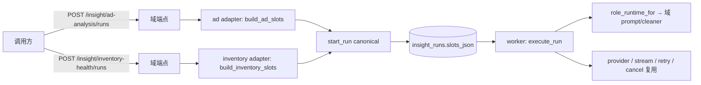

# BLF-1016 · 广告 / 库存 Insight Role Adapter 迁移与回滚记录

> **状态：** ✅ 交付（PR 待合并）
> **日期：** 2026-09-11
> **关联：** BLF-1016（Stage 4 后端）· BLF-1005（父）· BLF-1017（Stage 4 前端，Seth）
> **分支：** `blf-1016-...`（本地 worktree）→ `main`
> **迁移：** 无 Alembic 迁移（不改 schema、不动旧历史表）

---

## 一、交付形态：为什么不是"第二条 LLM 调用链"

| 层 | 归属 | 本 PR 是否新建 |
|----|------|----------------|
| provider / SSE stream / retry / cancel / 持久化 | `app/services/insight/{executor,provider,runs,stream}.py` | **否**，原样复用 |
| request 校验 / slot 契约 / 错误码表 | `app/services/insight/{validator,slot_types,contracts}.py` | **否**，仅泛化 scope 校验 |
| 角色注册 | `app/services/insight/roles.py` | 两个 reserved 占位 → `active` |
| **域 adapter（服务层库）** | `app/services/{ad,inventory}/insight_adapter/` | **是**（slots/prompt/submit 三件套） |
| **域提交入口（HTTP）** | `app/api/v1/endpoints/insight_domains.py` | **是**（2 个 POST） |

判断依据：域 adapter 里**没有**任何 LLM 客户端、没有 SSE、没有 run 状态机——它只做
「业务口径 → typed slots」的纯函数式组装（`slots.py`），再调 canonical 的
`start_run(...)`（`submit.py`）。两个 HTTP 入口是**唯一**能把「服务端组装 slots」
暴露给药的地方：canonical 端点 `/insight/runs` 要求调用方自带 slots，而业务口径
（project/country/日期）必须在服务端收敛为权限可审计的 slot。



---

## 二、可逆开关：`Settings.insight_canonical_domains`

```
insight_canonical_domains = ""                        # 默认 = 迁移前行为（旧链路唯一写端）
insight_canonical_domains = "ad_analysis"             # 只切广告域
insight_canonical_domains = "ad_analysis,inventory_health"  # 两域均切
```

语义在**两端同时**强制，因此域端点不会成为绕过开关的第二写端：

| 开关状态 | 旧写端点 | 域端点 |
|----------|----------|--------|
| 域 role **不在** CSV | 照常（现状） | **409** `DOMAIN_SWITCH_NOT_READY` |
| 域 role **在** CSV | **409** `DOMAIN_SWITCH_NOT_READY` | 可用（201 建 run） |

- 解析在 `app/services/insight/domain_switch.py`；未知值忽略（配置笔误不会打开未实现的域）。
- 门禁在域端点是**第一个**动作（`_require_domain_enabled`），早于任何数据读取与 run 建行。
- 开关关闭时线上功能与切换前逐字节一致——这是可直接回滚的原因。

### 回滚步骤

1. 从 `insight_canonical_domains` 移除该域（或整项置空）→ 重启 API（`systemctl restart believeboy-api`）+ worker。
2. 旧写端点立刻恢复；域端点立刻 409。**无需**数据迁移、**无需**回滚代码。
3. 已由 canonical 建出的 `insight_runs` 行保持只读可查（`GET /insight/runs/{id}`、stream 均不受开关影响）。

---

## 三、旧写端冻结：三类冻结点 + 不冻清单

冻结范围**精确**界定为「新建旧 `AIInsight` 行」的三个入口：

| # | 位置 | 行为 |
|---|------|------|
| 1 | `app/api/v1/endpoints/ai_insight.py` `_freeze_legacy_write`（`POST /ai-insights/generate`） | 命中 → 409 `DOMAIN_SWITCH_NOT_READY`，不建行 |
| 2 | `app/services/insight_schedule_service.py` `run_schedule_now` | 命中 → 抛 typed 409，不建行 |
| 3 | `app/celery_tasks/insights/generate.py` `generate_insight`（`insight_id is None` 分支） | 命中 → log + `return {"status": "domain_migrated", ...}`，**不建行、不报错** |

第 3 处是**静默不建行**而非失败：定时任务在切换瞬间仍在触发，报错只会制造噪声重试；
返回值里带 `domain` / `schedule_id` 供排查。

### 明确「不冻」

- 携带**显式** `insight_id` 的在途生成（已建行的 run-to-completion）。
- 全部读路径：`GET` 列表 / 详情、SSE stream、retry **读**语义、旧前端页面。
- `AIInsight` 表结构、历史数据、任何 Alembic 迁移。
- 其它 `InsightType`（`daily`/`weekly`/`monthly`/`custom`）——`LEGACY_INSIGHT_TYPE_ROLES` 只列 `ad_analysis`。
- 库存域**没有**旧 `InsightType` 成员（`models/ai_insight.py` 无库存类型），故无第 4 个冻结点。

冻结是**建行级**而非请求级，否则切换瞬间的 pending 旧行会永久悬挂。

---

## 四、CodeGraph 影响面（depth 2）

| 符号 | 结论 |
|------|------|
| `start_run` | 5 处 caller：`insight_runs.create_insight_run`（既有 canonical 端点）、`scheduled_report/insight_adapter/submit._submit_one`、测试。**签名未改**，两域 adapter 属新增 caller |
| `execute_run` | 唯一生产 caller `celery_tasks/insights/run.execute_insight_run`；其余为 durability 测试。未改 |
| `role_runtime_for` | 3 处：`executor.execute_run:427`（生产）+ 2 处测试。**本轮改**为「按 `role.role_id` 延迟 import 域 prompt 三件套」，传参仍是 role 对象 → 既有调用方零改动 |
| `create_run` | 唯一生产 caller `executor.start_run:646`。未改 |
| `latest_inventory_snapshot_date` | 新增公开函数：caller = `inventory/insight_adapter/slots.build_inventory_slots` + `replenishment._compute_snapshot_age_days`（原逻辑改为转调，行为不变） |
| `list_inventory_replenishment_analysis` | 8 处 caller（Agent API 4 + 前端 API 2 + 其它）。**签名未改**，adapter 是新增 caller（读同一函数，保证口径一致） |
| `run_ad_agent_pipeline_multi_pass_stream` | 唯一 caller `ai_insight_runtime_service.run_insight_generation`（旧链路）。**未触碰**——legacy 多轮 ad pipeline 留在旧链路 |
| `run_schedule_now` | 唯一 caller `ai_insight.run_insight_schedule_now`。加了冻结前置检查，非冻结路径行为不变 |
| `generate_insight` | Celery 按名注册（无静态 caller）。新增 `insight_id is None` 分支的冻结检查 |
| `AIInsight` | 3 处构造点（`insight_schedule_service:398`、`ai_insight:147`、`celery_tasks/.../generate:65`）全部为冻结点所覆盖的入口 |
| `JsonEnvelopeSlot` / `ReportDataSlot` | impact 7 个符号，均在 `slot_types.py` 内 + 新增两个 data slot。**两处收紧**：`json_safe()` 前置归一化 + after-validator 兜底；`_reject_stringified` 由 `TypeError` 改 `ValueError`（`TypeError` 会绕过 pydantic 包装成裸 500，`ValueError` 才映射成 typed 422）。既有 `schedule_report` 的 slot 全部本就是 JSON 原生 → 无行为变化 |
| `strip_outer_code_fence` | 新增于 `services/insight/markdown.py`，caller = 两域 prompt cleaner。**有意不复用** legacy `ai_insight_generator.normalize_insight_markdown`（它带旧域特化改写，canonical 侧只剥围栏） |
| `InsightRunRequest` / `InsightRunResponse` | 契约未改；域端点复用同一响应模型 |

---

## 五、测试证据

| 套件 | 结果 |
|------|------|
| `backend` 全量 `pytest` | 见 PR「测试声明」块（含 redis 起停口径说明） |
| `tests/insight` + `tests/services/scheduled_report` + 两个域 adapter 测试 | 311 passed |
| `tests/services/inventory/test_inventory_insight_adapter.py` | 26 passed |
| `tests/insight/test_domain_switch.py` | 18 passed |
| `tests/api/test_insight_domain_runs.py` | 11 passed |
| `frontend` `lib/insight/contract-fixture.test.ts` | 13 passed |
| `backend/scripts/check_alembic.py` | 通过（本 PR 无迁移） |
| `export_insight_contract.py --check` | `contract in sync: 6 artifact(s)` |

残余失败（`test_page_render` / `test_profile_endpoints` / `test_platform_inspection` /
`test_inventory_replenishment` / `test_seasonal_replenishment` / CRM reminder）已在
`origin/main` 基线 worktree 上复现**同一失败集合**（`IDENTICAL_FAILURE_SET`），为环境
缺 R2 凭据 / 既有脏数据，与本 PR 无关。

---

## 六、交给下游

- **BLF-1017（前端，Seth）**：两个 role 已 `active`，契约产物已重生成
  （`frontend/types/api-generated/insight-contract.json`，388 行增量）；
  `contract-fixture.test.ts` 的两条 availability 断言已随之由 `reserved` 改 `active`。
  页面/组件迁移仍归 BLF-1017。
- **观察期**：迁移后旧读路径与 `AIInsight` 表保留；删除旧表 / 移除旧读路径不在本
  PR（属 Stage 5 及以后）。
