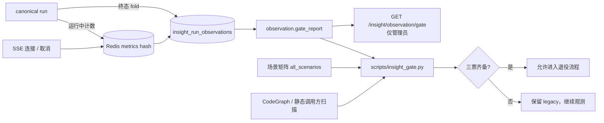

# BLF-1018 · Insight 观测期质量 / 成本门禁（Stage 5 后端）

> **状态：** 已交付（PR 待合并；legacy 退役**未执行**，等三票齐备）
> **日期：** 2026-09-12
> **关联：** BLF-1018（Stage 5）· BLF-1005（父）· BLF-1017（Stage 4 前端，Seth）
> **分支：** `agent/damon/blf-1018` → `main`
> **迁移：** `20260912_271_insight_run_observations.py`（新增观测表；revision `271` ← `270`）
> **运行文档：** [`INSIGHT_OBSERVATION_GATE.md`](../../../INSIGHT_OBSERVATION_GATE.md)

---

## 一、这一层解决什么问题

Stage 1–4 已经把 canonical Insight 链路（provider / SSE / retry / cancel / 持久化 / 域 adapter）
做完并切了两个域（`ad_analysis`、`inventory_health`）。Stage 5 要回答的不是「功能对不对」，
而是两个工程问题：

1. **能不能观测**：新链路的时延、用量、重连、取消、降级，有没有可信、脱敏、可审计的账？
2. **能不能退役**：legacy `/ai-insights` 写路径什么时候可以删？凭什么删？

判断依据：**先有证据，再退役**。删表 / 删历史这类不可逆动作**不在本阶段**（验收 §3 与
BLF-1018 非目标都写死了「保留历史只读兼容」，且禁止在门禁通过前删除历史模型）。

## 二、交付形态

| 层 | 文件 | 新建/改动 |
|----|------|-----------|
| 观测表 | `backend/app/models/insight_run_observation.py` + 迁移 `271` | 新建 |
| 指标 + 门禁服务 | `backend/app/services/insight/observation.py` | 新建 |
| 传输层计数 | `backend/app/services/insight/stream_bus.py`、`sink.py` | 改动（Redis 计数、首帧时延） |
| 终态落账 | `backend/app/api/v1/endpoints/insight_runs.py`（SSE / cancel）、`celery_tasks/insights/run.py` | 改动 |
| 并发 / 成本闸门 | `backend/app/services/insight_concurrency.py`、`celery_tasks/insights/run.py` | 改动（canonical run 补桶闸门） |
| 降级打点 | `scheduled_report/ai_schedule_report.py`、`celery_tasks/ai_summary.py` | 改动 |
| 只读端点 | `backend/app/api/v1/endpoints/insight_observation.py` + `schemas/insight_observation.py` | 新建（管理员级） |
| 门禁脚本 | `backend/scripts/insight_gate.py` | 新建 |
| 测试 | `tests/insight/test_observation.py`（33）、`tests/insight/test_quality_gate_scenarios.py`（10） | 新建 |

**为什么单开一张表**：`insight_runs` 里没有首字时延、重连次数、取消是否真的落地、
Stream 水位/内存这些字段；从 run 表反推不出来。观测表只增不改，旧链路完全不受影响。

**为什么先冻结而不是先删**：`Settings.insight_canonical_domains`（既有开关）已经实现
「恰好一个写入方 / 冻结 / 不双写」。复用它是零新概念的退役闸门；回滚 = 清空 CSV。
新造一个平行开关只会多一个会漂移的状态源。

## 三、关键判断（含被测试抓出来的两个洞）

1. **首字时延的锚点在 open 时才可能为空**（`success` 场景抓出来的洞）。
   任务在 `execute_run` 之前就 `sink.open()`，那一刻 run 还是 `queued`（`started_at` 为 `None`），
   于是「距起点时延」在生产路径上**永远是空的**。修法：`open()` 拿到行就取，
   取不到就在首个 `on_status`（`started_at` 刚被 `try_transition` 盖上）补，两处都做
   naive → aware UTC 归一；不许静默吞算术异常。
2. **终态行不能因为 Redis 抽风而丢**（`test_finalize_survives_metric_transport_outage` 抓出来的）。
   `finalize_run_observation` 里读指标那一步单独兜异常：指标可空，审计行必须在。
3. **空窗口不算达标**。门禁的意义是拿证据说话；无样本时返回
   `insufficient_data:insight.runs=0`，而不是「没有 blocking finding ⇒ 通过」。
4. **`0` 阈值 = 不判定**，不是「必须为 0」。默认阈值只在仓库已有硬数字处取值
   （`soft_time_limit=300s`、`ai_chat_timeout_seconds`、`insight_stream_maxlen`）；
   成本倍数 5.0 明确标注为运维经验值。
5. **`ai_summary` 桶不参与 canonical 结论**。它是待退役对象，它的降级不能挡新链路；
   反之门禁脚本对「canonical 未承接的 target」直接给「本阶段不退役」，而不是算成「未清零」。
6. **静态调用图看不见 `.delay()`**，所以「调用方清零」的定义是
   「静态扫描 0 个未知调用方 + 全部派发点在退役集合内」，且这条限制随证据一起输出。

## 四、验证

- `tests/insight/test_observation.py`：33 passed（指标聚合 / 门禁语义 / 退役投票 / 脱敏矩阵含列白名单）。
- `tests/insight/test_quality_gate_scenarios.py`：10 passed（success / failure / cancel / retry /
  reconnect / permission_escalation / cost_anomaly / rollback_drill + 2 项矩阵完备性）。
- `scripts/insight_gate.py` 在本地 BLF_test 上真跑两条路径：空窗口 → 退出码 1
  （`insufficient_data:insight.runs=0`）；播一条 completed 观测行 → 退出码 0（全票通过）。
- `scripts/check_alembic.py`：单 head、命名合规、无重复 id。
- 全量 `pytest` 见 PR 测试声明。

## 五、留给后续阶段

- legacy 退役**执行**（本 PR 只出证据与清单）：等观测窗口跑够、三票齐备、负责人拍板。
- 前端退役面（BLF-1017 / Seth）：旧轮询 → SSE、旧 `ai-insights` 客户端 → `lib/insight/client.ts`。
- `openapi.json` 重生成被全仓库的 `fastapi==0.139.0` + 未固定 `pydantic` 组合挡住，属独立问题。
